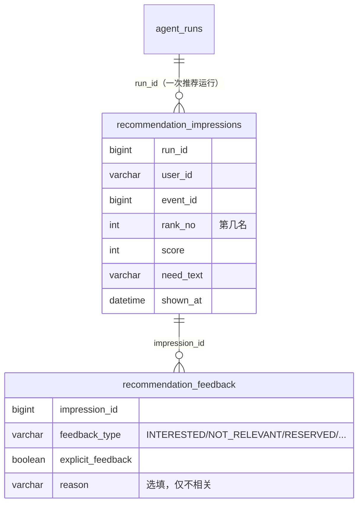

# B1：推荐曝光与反馈（显式 + 隐式）

> 一句话：以前推荐给出去之后，系统并不知道学生满不满意。现在每次推荐都会把“给谁推荐了什么、排第几”记成**曝光**；学生可以在卡片上点“感兴趣 / 不相关”（不相关可以选填原因），这是**显式反馈**；推荐后 7 天内的预约、取消预约、完成、关注该组织，会自动算到这次推荐上，这是**隐式反馈**。学生标了“不相关”的活动，之后不会再推荐给他。
>
> **状态（2026-10-24）**：已完成。Maven 全量 164 个测试通过（新增 11 个），前端构建通过；在真实环境里走通了“推荐 → 不相关 → 再推荐被过滤 → 撤销”和四种隐式反馈（待人工验收）。

---

## 1. 数据模型：为什么是“曝光 + 反馈”两张表

**为什么要单独记曝光**：只有反馈表是算不出比率的。“感兴趣率 = 感兴趣次数 ÷ **推荐次数**”，分母就是曝光。推荐系统里常说的 CTR、转化率，分母都是曝光；没有曝光记录，B2 的面板就没法算任何比率。曝光记录也是最可靠的证据，能证明某个活动确实推荐给过这个学生。

**为什么反馈挂在曝光上，而不是直接挂在“学生 + 活动”上**：同一个活动可能被推荐过很多次。挂在具体某次曝光上，就能知道是哪一次推荐（哪个需求、排第几、哪次运行）带来了这个反馈。之后要对比两个推荐策略的效果，也必须靠这个。

**唯一约束 `(impression_id, feedback_type)`**：同一次曝光，同一种反馈只记一次。学生取消后又预约、或者点了两次关注，都不会重复计数。这个约束放在**数据库层**，而不只是在代码里先查再插，因为“先查再插”在并发下会漏。

**`run_id` 打通 trace**：曝光记录了产生它的 `EVENT_RECOMMENDATION` 运行 ID，所以以后在运维面板里，可以从某条差评一路点到那次推荐的完整 trace（召回了哪些候选、模型是怎么排的）。

---

## 2. 关键设计决策

### D1：隐式反馈用“领域事件 + 提交后监听”，不直接在业务代码里写

**问题**：预约、取消、完成、关注都发生在各自的业务服务里。最直接的写法，是在 `ReservationService.reserve()` 里直接调用 `feedbackService.record(...)`。

**这样写有两个风险**：
1. 记录反馈失败（比如表被锁）会让整个预约失败。学生只是想预约，结果因为统计代码出错而预约不上。
2. 如果反馈先写了，后面预约又因为别的原因回滚，就会留下一条“已预约”的反馈，但实际上没有预约。

**选择**：
- 业务服务只发布一个事件 `RecommendationActivityEvent`（谁、哪个活动、什么动作），**不知道也不关心**推荐反馈的存在。
- 监听器使用 `@TransactionalEventListener(phase = AFTER_COMMIT)`：**只有预约真正提交成功后才执行**；预约回滚了，就什么也不发生。
- 监听器里再开一个**新事务**（`REQUIRES_NEW`），并且吞掉所有异常，只记一条日志。所以反馈记录失败不会影响预约。

这是典型的**解耦和可靠性取舍**：统计数据是“尽力而为”的，业务动作必须可靠。代价是在极端情况下（应用恰好在提交后、记录反馈前崩溃）会漏记一条反馈。对统计用的数据来说，这可以接受。如果以后反馈变成计费依据，就要改成 Outbox，和之前处理 MQ 消息的方式一样。

### D2：归因规则：7 天窗口，归到最近一次曝光

学生预约活动 58 时，往前查找“7 天内、给这个学生推荐过活动 58 的最近一次曝光”：
- 找到了，就挂上 `RESERVED`；
- 没找到，说明这次预约和推荐无关（比如学生是自己搜到的），**不记反馈**。

关注的是组织而不是某个活动，所以“关注”会归到“7 天内推荐过的、属于该组织的最近一个活动”。

**为什么是最近一次**：这叫“最后触点归因”（last-touch attribution），是广告和推荐里最常用、也最好解释的规则。它的局限是会把功劳全记在最后一次推荐上；如果学生是看了三次推荐才下定决心，前两次就没有记功。现阶段这样够用。

### D3：显式反馈：“最新的点击为准”，可以改主意

- 同一次曝光只保留一条显式反馈：先删掉旧的，再写新的。点了“感兴趣”再点“不相关”，最后记的是“不相关”。
- 提交 `type: null` 就是撤销。
- 判断是否过滤时，看的是**这个学生对这个活动的最新一次显式反馈**（可能来自不同的推荐运行）：最新是“不相关”就过滤；后来改成“感兴趣”或撤销了，就不再过滤。

**安全边界**：
- 只能评价**推荐给过自己的**活动。用 `runId + 当前用户 + eventId` 查曝光，查不到就返回 404，不能替别人点，也不能评价从没推荐过的活动。
- 隐式类型（预约、完成等）**不能手动提交**，返回 400，否则用户可以伪造转化数据。

### D4：“不相关”的过滤放在召回之后、重排之前

在 `AiService.recommendEvents` 里，召回得到候选之后、交给大模型重排之前，把学生标过“不相关”的活动去掉，并在 trace 里记一条 `SUPPRESSED_BY_FEEDBACK`（说明去掉了哪些活动）。

**为什么放在这里**：
- 放在召回之前，就要改检索查询，侵入性太大。
- 放在重排之后，模型已经为这个活动花了 token，去掉之后还可能导致展示数不够。
- 放在重排之前，模型根本看不到这些活动，候选位也能让给别的活动。

**这是结构性约束，不是语义判断**：这条规则只处理“学生明确说过不要的那一个活动”，不会去猜“和它相似的活动也不要”。相似活动要不要降权，留给 B3 交给模型通过画像去判断，这和我们定的原则一致。离线评测（B0）的 `rankForEvaluation` 不走这个过滤，因为评测使用的是中性画像。

### D5：一个差点踩中的坑：只读事务里写不进数据

`recommendEvents` 标了 `@Transactional(readOnly = true)`。如果曝光记录直接加入这个事务，写入会失败：修改已查出的对象时，只读事务不会同步到数据库，改动悄悄丢失；插入新记录时（我们的表用自增 ID），INSERT 会立刻执行，但连接已经是只读的，MySQL 会报错。又因为记录曝光包在 try/catch 里，这个报错只会变成一条警告日志，推荐照常返回，曝光表却一直是空的。所以 `recordImpressions` 用了 `REQUIRES_NEW`，自己开一个可写的事务。这类 bug 的特点是本地看起来一切正常，表里却一直是空的。（2026-10-24 更正：原先写的是“不会报错”，不准确。详见 [学习笔记_事务边界与Spring代理.md](学习笔记_事务边界与Spring代理.md) 第 2 节。）

### D6：记录曝光失败不能影响推荐

记录曝光包在 try/catch 里，失败只打一条日志，推荐照常返回，和 D1 是同一个原则。

---

## 3. 请求路径

**显式反馈**
1. 推荐返回时，`GuideChatResponse` 和 `EventRecommendationResponse` 都带上运行 ID。前端把它保存为 `recommendationRunId`。
2. 点“不相关”，填写选填的原因，提交 `POST /api/recommendations/feedback {runId, eventId, type, reason}`。
3. 后端校验类型 → 按 `runId + 当前用户 + eventId` 找到曝光 → 删掉旧的显式反馈 → 写入新反馈。
4. 下次推荐：召回 → 读取该学生最新的显式反馈 → 过滤掉被标为“不相关”的活动 → 重排。

**隐式反馈**
1. `ReservationService.reserve()` 提交事务。
2. 事务提交后，监听器收到 `RecommendationActivityEvent(RESERVED)`。
3. 在新事务里：查 7 天内最近一次曝光 → 如果已经记过同类反馈就跳过 → 写入反馈。

---

## 4. 测试与验证

**单元测试（11 个）**：最新一次显式反馈决定是否过滤（包括改主意的两种情况）；曝光记录的名次、分数和运行 ID；“不相关”会替换旧反馈并保留原因；撤销后不写新行；不能评价没推荐给自己的活动（404）；不能手动提交隐式类型（400）；预约归到窗口内的曝光；没有曝光就不记反馈；同一动作只记一次；关注通过组织归因；监听器吞掉异常，不影响业务。

**真实环境验证**：
1. 引导 Agent 推荐了活动 58，生成运行 160，曝光表里多了一行（第 1 名，93 分）。
2. 标记 58 为“不相关”后，再次推荐，58 被过滤；运行 162 的 trace 里出现 `SUPPRESSED_BY_FEEDBACK`。
3. 撤销成功；伪造“完成”类型返回 400；评价没推荐过的活动返回 404。
4. 关注 Kansai Career Tech、取消预约、重新预约，分别生成了 `FOLLOWED`、`RESERVATION_CANCELLED`、`RESERVED` 三条隐式反馈，都挂在曝光 1 上。demo 账号的关注和预约状态已恢复原样。
5. 浏览器里卡片显示“感兴趣 / 不相关”按钮，点“不相关”会弹出原因输入框。

**没有覆盖的**：
- “完成”反馈（扫码签到）没有在真实环境里触发过，需要活动当天才能扫码；逻辑由单元测试覆盖。
- 反馈还没有被任何地方“消费”：画像（B3）和面板（B2）都还没用到。
- 直接调用的推荐接口 `/api/ai/event-recommendations` 也会返回运行 ID，但前端目前只在引导对话里接入了反馈按钮。

---

## 5. 局限

| 局限 | 影响 | 后续 |
| --- | --- | --- |
| 最后触点归因 | 多次推荐共同促成的决定，只记在最后一次上 | 数据多了以后可以改成按权重分摊 |
| 提交后监听不是 100% 可靠 | 应用崩溃时可能漏记一条 | 反馈如果变得重要，就改走 Outbox |
| 曝光会一直累积 | 表会持续增长 | 以后对超过 90 天的曝光做归档 |
| 没有记录“展示了但没理”的负反馈 | 忽略也是一种信号，现在区分不出 | 曝光多、反馈少本身就是信号，B2 可以算出来 |

---

## 6. 可迁移的模式

1. **曝光是分母**：凡是要算比率的系统（推荐、广告、搜索），都要先记录“展示了什么”。
2. **统计不能拖垮主业务**：业务服务发布领域事件，统计逻辑在事务提交后监听、开新事务、吞掉异常。
3. **约束放在数据库层**：去重靠唯一约束，不靠“先查再插”。
4. **只读事务里不能写**：需要写的辅助操作要用 `REQUIRES_NEW`。
5. **用户明确的选择用结构性规则处理，语义推断交给模型**：“这个不要”是用户的选择，可以直接执行；“类似的也不要”是推断，交给模型判断。

---

## 7. STAR

- **S**：推荐系统没有任何反馈数据，无法知道推荐好不好，也无法让推荐越用越准。
- **T**：建立推荐曝光和反馈的数据闭环，同时不影响推荐和预约等主流程的可靠性。
- **A**：设计“曝光 + 反馈”两张表，用唯一约束去重，用运行 ID 打通 trace；显式反馈以最新一次为准、可以撤销，只能评价推荐给过自己的活动；隐式反馈通过领域事件和提交后监听实现，在新事务里吞掉异常；按 7 天窗口做最后触点归因；在召回之后、重排之前过滤掉学生标为“不相关”的活动并记录 trace；发现并规避了只读事务写不进数据的问题。
- **R**：真实环境里走通了完整闭环；新增 11 个测试，全量 164 个通过；推荐和预约主流程的行为不变。

---

## 8. 文件清单

**新增**
- `db/migration/V29__add_recommendation_feedback.sql`
- `recommendation/`：`RecommendationImpressionEntity`、`RecommendationFeedbackEntity`、`RecommendationFeedbackType`、两个 Repository、`RecommendationFeedbackService`、`RecommendationFeedbackController`（`POST/GET /api/recommendations/feedback`）、`RecommendationFeedbackDtos`、`RecommendationActivityEvent`、`RecommendationActivityListener`
- 测试：`RecommendationFeedbackServiceTest.java`

**修改**
- `ai/AiService.java`：召回后过滤“不相关”的活动并记录 trace；记录曝光；响应里带上运行 ID
- `ai/AiDtos.java`：`EventRecommendationResponse.runId`
- `guide/GuideRagToolService.java`、`GuideController.java`、`GuideDtos.java`：把运行 ID 透传为 `recommendationRunId`
- `reservation/ReservationService.java`：预约、取消、完成时发布事件
- `follow/FollowService.java`：新关注时发布事件
- 前端：`types/events.ts`、`api/events.ts`、`views/StudentEventsView.vue`（按钮、原因输入框、撤销）、`styles/main.css`
