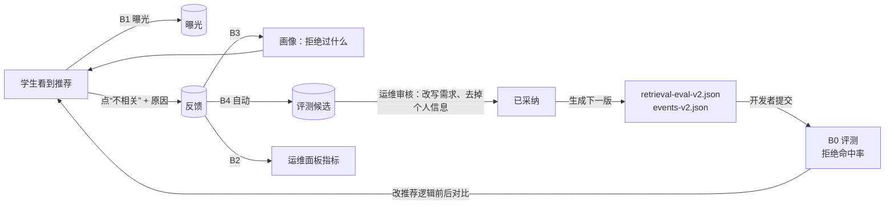

# B4：差评转评测用例

> 一句话：学生每点一次“不相关”，系统就生成一条**评测候选**：“对这个需求，这个活动不应该出现在前 5 名”。运维人员在面板上审核：采纳前可以改写需求原文、去掉个人信息；采纳之后点“生成下一版评测集”，系统输出升级了版本号的评测集文件（如果涉及新活动，还会一并输出新版语料文件），**由开发者检查后提交到仓库**。评测新增“拒绝命中率”指标，衡量被拒绝过的活动有没有又被推荐出来。
>
> **状态（2026-10-24）**：已完成。Maven 全量 182 个测试通过（新增 9 个），前端构建通过。真实环境里走通了“不相关 → 生成候选 → 改写后采纳 → 导出 v2 + events-v2 → 撤销反馈不影响已审核的候选”（待人工验收）。

---

## 1. 闭环全貌（方向 B 收尾）

线上的差评有两个去处：**短期**进入画像（B3），影响这个学生下一次的推荐；**长期**进入评测集（B4），以后每次修改推荐逻辑都要过这一关，同类错误不会悄悄回来。

---

## 2. 关键设计决策

### D1：运行中的系统不改写自己的评测集

**问题**：采纳的用例怎么进入评测集？最直接的做法是存在数据库里，评测时把“文件里的用例 + 数据库里已采纳的用例”合在一起。

**为什么不这样做**：那样的话，同一个版本号 `retrieval-eval-v1` 今天和明天包含的用例可能不同，B0 里定下的“版本号相同才能比较”就失效了。而且评测集的变化不会出现在 git 历史里，也没有人审查。

**选择**：
- 数据库只负责审核流程：待审核、已采纳、已驳回。
- “生成下一版”是一个**纯函数**：输入当前文件、已采纳的用例和活动快照，输出新文件的内容。它**不写任何东西**，可以反复点。
- 新文件由开发者下载、检查，放进 `resources/retrieval-eval/` 之后提交。**评测集只能通过 git 提交改变**，版本号和 changelog 也都在文件里。

这和数据库迁移（Flyway）是同一个思路：结构的变化要有版本、可审查、可回溯，不能在运行时悄悄改。

### D2：需要新活动时，语料一并升级版本

候选里被拒绝的活动（比如 #58）可能还不在冻结语料 `events-v1` 里。导出时会：
- 从数据库取出这个活动和它的质量报告，按冻结文件的格式做成快照，追加到语料里，语料版本升为 `events-v2`；
- 评测集的 `corpusVersion` 也指向 `events-v2`；
- 因为语料内容变了，B0 的指纹会变，评测索引会**自动重建**，不用手动处理。

如果所有候选涉及的活动都已经在语料里，就只升级评测集版本，语料不动。

**会跳过并给出警告的情况**：活动已经被删除；活动在评测时钟 `asOf` 之前就已结束（评测时会被当作过期，这条用例就没有意义）。

### D3：新指标“拒绝命中率”，而不是硬塞进 NDCG

**问题**：从差评来的用例只知道“这个活动不该出现”，并不知道“哪个活动是对的”。NDCG 需要正确答案，这种用例算 NDCG 永远是 0，会把平均分拉低，造成误导。

**选择**：
- 用例格式新增 `rejectedEventIds`（不该出现的活动）和 `source`（来源，例如 `feedback:candidate-12`）。
- 新指标**拒绝命中率** = 被拒绝的活动仍然出现在前 5 名的用例占比。**越低越好**，理想值是 0。
- 命中率、NDCG、MRR 只统计**有正确答案的用例**，拒绝命中率只统计有被拒绝活动的用例。两类指标各管各的，不会互相干扰。

一个用例也可以同时有正确答案和被拒绝的活动，以后人工补标时就会出现这种情况。

### D4：个人信息不能进入公开仓库

**风险**：需求原文是学生自己写的，可能包含姓名、学校、时间安排等个人信息，而我们的 GitHub 仓库是公开的。

**措施**：
- 导出的用例**只包含需求、活动 ID、原因和审核备注，没有 userId**。有测试专门检查导出的 JSON 里不会出现 `userId`。
- 采纳时可以改写需求，面板上明确提示“删除个人信息”；需求为空时不能采纳。
- 学生原话里的原因会写进 `note`，所以审核时也要看一眼原因。

### D5：学生撤销时，候选怎么处理

- 还没审核的候选：学生撤销了“不相关”，候选也一起删除，说明他自己也不确定。
- 已经审核过的候选：保留不动。运维的判断已经做出，而且这条用例可能已经导出了，不能因为学生改主意就悄悄消失。

---

## 3. 测试与验证

**新增 9 个单元测试**：
- 导出：新活动会让评测集和语料都升版本，并且**导出的文件能被真实的读取代码重新读进来**（这是最关键的一条测试：导出的格式必须和手写的文件完全兼容）；导出内容不含 userId；只涉及已冻结活动时，只升评测集版本；已经导出过的用例不会重复导出，也不会白白升版本；已删除或已过期的活动会被跳过并给出警告；版本号递增规则（v9 → v10）。
- 候选：“不相关”会生成候选，带上需求和原因；撤销会删除未审核的候选，已审核的保留。
- 指标：被拒绝的活动出现在前 K 名时会被找出来，排在第 K 名之后则不算。
- 评测集一致性测试改成兼容 v2：人工用例必须有正确答案，反馈用例必须有被拒绝的活动，所有引用到的活动都必须在对应版本的语料里。

**真实环境**：
1. 对运行 164 的活动 58 点“不相关”，原因是“工作日晚上要上课”，生成了候选 #1。
2. 改写需求后采纳，导出得到 `retrieval-eval-v2` 和 `events-v2`（55 → 56 个活动），新用例 `feedback-1` 的被拒活动是 `[58]`，不含 userId。
3. 学生撤销“不相关”后，已采纳的候选仍然保留。
4. 测试结束后，候选 #1 已驳回，备注写明“B4 验收测试数据”。**没有提交任何新版评测集文件**，仓库里仍然是 v1。
5. 浏览器里审核区显示正常。

**没有覆盖的**：拒绝命中率还没有在真实评测里跑过，因为评测集里目前没有反馈用例。

---

## 4. 方向 B 总结

| 阶段 | 解决的问题 | 主要做法 |
| --- | --- | --- |
| B0 | 评测集失效、结果不可比 | 冻结语料、版本号、固定时钟和中性画像、端到端评测 |
| B1 | 不知道学生满不满意 | 曝光和反馈两张表、提交后监听记录隐式反馈、“不相关”过滤 |
| B2 | 数据有了但看不到 | 以曝光为分母的指标、按推荐当天统计、零结果率 |
| B3 | 反馈没有影响推荐 | 模型从反馈中归纳“接受 / 拒绝”写进画像，本次需求优先 |
| B4 | 线上的错误会再犯 | 差评转候选、人工审核、导出新版本、拒绝命中率 |

**还没做的**：
- 评测集 v2 加入“指定画像”的用例，用来量化 B3 的效果。
- 第一次真实评测，得到基线。
- 活动供给问题：零结果率 42.9%，需要运营侧补充活动，不是算法能解决的。

---

## 5. 可迁移的模式

1. **评测集和代码一样，走版本管理**：运行中的系统只产出“建议”，由人审核、提交后才生效。
2. **会影响结果的数据变化，必须改版本号**：语料一变指纹就变，索引自动重建。
3. **一个指标只回答一个问题**：“该出现的有没有出现”和“不该出现的有没有出现”分开衡量。
4. **数据进入公开仓库之前要过一道人工关**：只导出需要的字段，并提示审核人删除个人信息。
5. **生成文件的函数要用真实的读取代码做往返测试**。

---

## 6. STAR

- **S**：学生的“不相关”只影响他自己的下一次推荐；同类错误在改推荐逻辑之后可能再次出现，而且没有人发现。
- **T**：把线上差评沉淀为可回归的离线评测用例，同时保证评测集可追溯、不泄露个人信息。
- **A**：“不相关”自动生成候选；运维审核时可以改写需求、去掉个人信息；导出是纯函数，生成新版评测集，必要时连带升级语料版本，由开发者提交；新增拒绝命中率，并把正向和反向指标分开统计；用往返测试保证导出的格式和手写文件兼容。
- **R**：方向 B 的闭环完成：推荐 → 反馈 → 画像 → 评测 → 改进；新增 9 个测试，全量 182 个通过。

---

## 7. 文件清单

**新增**
- `db/migration/V31__add_recommendation_eval_candidates.sql`
- `recommendation/EvalCandidateEntity.java`、`EvalCandidateRepository.java`、`EvalCandidateStatus.java`
- `ops/EvalSetExport.java`（纯函数）、`ops/OpsEvalCandidateService.java`
- 前端：`components/ops/OpsEvalCandidates.vue`
- 测试：`ops/EvalSetExportTest.java`

**修改**
- `recommendation/RecommendationFeedbackService.java`：“不相关”时生成或更新候选，撤销时删除未审核的候选
- `retrieval/RetrievalDtos.java`：用例新增 `rejectedEventIds` 和 `source`，结果和汇总新增拒绝命中相关字段
- `retrieval/RetrievalEvalService.java`：计算拒绝命中率；正向指标只统计有正确答案的用例（A/B 对比同样处理）
- `retrieval/eval/RetrievalEvalFixtures.java`：`rawEvalSet()`、`rawCorpus()`、`corpusFileName()`
- `ops/OpsDtos.java`、`ops/OpsController.java`：`GET /api/ops/eval-candidates`、`POST /{id}/review`、`GET /eval-candidates/export`
- 前端：`api/ops.ts`、`components/ops/OpsRecommendations.vue`（嵌入审核区）、`styles/ops.css`
- 测试：`RecommendationFeedbackServiceTest`、`RetrievalEvalMetricsTest`、`RetrievalEvalSetTest`（兼容 v2）
