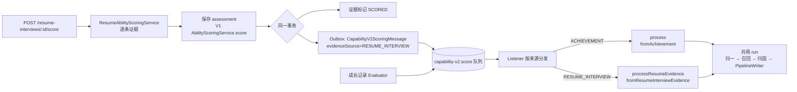

# Stage 12.1：简历定段接入 V2 双标签链路

> 一句话：简历定段原来只往 V1 旧能力表里加分，而能力档案页只读 V2，所以用户做完定段什么也看不到。现在 V1 照旧，**在同一个事务里再通过 Outbox 投一条 V2 消息**，让每条面试证据走和成长记录完全相同的“知识归一 → 职能归因 → Java 评分”链路。
>
> **状态（2026-10-21）**：代码完成，Maven 全量 122 个测试通过（新增 12 个）。**未做真实环境验收**（需要重启后端，完成一次简历定段）；历史简历证据的回填尚未实现。

---

## 1. 为什么要改

| 现象 | 根因 |
| --- | --- |
| 做完简历定段，被引导到能力档案，却看不到任何来自简历的标签 | 定段评分只调用 V1 `AbilityScoringService.score(...)`；Stage 14 起前端只读 V2 |
| V2 早有 `fromResumeInterviewEvidence` 适配器 | 全项目没有调用方，Stage 06 之后一直没接线 |
| 即使接上，模型也看不到简历内容 | 适配器给模型的只有“简历面试：岗位”和一句固定描述；回答原文藏在 `structuredPayloadJson`，而两个 Agent 的 prompt 都不读这个字段 |

第三点是读代码时发现的：如果只把消息接通，链路会“跑通”，但模型拿不到任何事实，结果只会是全部 SKIP 或者乱归因。所以“接线”和“补内容”必须一起做。

---

## 2. 架构位置

这是一条**写链路**，上游是简历定段的同步评分请求，下游是 V2 能力账本（`user_capability_v2_states`、`capability_v2_evidence_links`、`capability_v2_score_audits`）。

V1 的行为一行没变：同步接口仍返回 V1 定段结果，旧表照写。V2 是旁路，失败不影响定段。

---

## 3. 关键设计决策

### D1：在现有消息上加“来源”字段，而不是新开一个消息类型和队列

| 备选 | 优点 | 代价 |
| --- | --- | --- |
| 新消息类型 + 新队列 + 新 Listener | 类型最干净 | 要新增路由、队列、绑定配置；延迟重投、退避、放弃日志全部再写一遍 |
| **在 `CapabilityV2ScoringMessage` 上加 `evidenceSource` 和 `resumeEvidenceId`（选中）** | 队列、Outbox 延迟重投、退避策略原样复用；Listener 只多一个分支 | 消息里出现“按来源二选一”的字段，需要校验组合是否合法 |

兼容性是这个选择的关键：Outbox 里可能还躺着 Stage 17 之前写入的旧消息。新字段缺失时，构造器把 `evidenceSource` 补成 `ACHIEVEMENT`，所以旧 payload 反序列化后语义不变（有专门的单测用旧 JSON 验证）。辅助方法故意命名为 `fromResumeInterview()` 而不是 `isResumeInterview()`，避免 Jackson 把它当成属性序列化进 payload。

### D2：在“标记 SCORED”的事务里投递，而不是在整个定段完成后批量投递

定段是逐条证据处理的，每条证据有自己的小事务。把投递放进这个事务：

- **原子性**：证据变成 `SCORED` 和 V2 消息写入 Outbox 同生同死。不会出现“V1 加了分但 V2 永远没收到”，也不会出现“回滚了却留下一条 V2 消息”。
- **天然去重**：`scoreCandidate` 开头会跳过已经 `SCORED` 且有结果 ID 的证据，所以定段中途失败后重试，已经投过的证据不会再投第二次。

代价：上线前已经定段完成的历史证据不会被投递，需要单独的回填入口（见第 6 节）。

### D3：共用一个 `run(...)`，两个入口只负责“取证据 + 校验归属”

`CapabilityV2AsyncScoringService` 原来的 `process` 拆成两部分：

- 入口（`process` / `processResumeEvidence`）：调用各自的适配器、做各自的归属校验；
- `run(...)`：资格判断、重复投递短路、trace、两个 Agent、`PipelineWriter` 单事务写入——一行都没有复制。

这样，模型不可用时抛 `CapabilityModelUnavailableException` → Listener 延迟重投的机制自动对简历生效；trace 也是同一个 `CAPABILITY_V2_PIPELINE` run，只是输入摘要从 `recordId=...` 变成 `resumeEvidenceId=...`。

### D4：归属校验换一种锚点

成长记录的校验是“评估任务的 `achievementRecordId` 等于消息里的 `recordId`”。简历评估的任务没有成长记录，所以换成三条：

1. 评估 ID 必须等于这条简历证据自己记录的 `abilityAssessmentId`（由 V1 在同一事务里写入，所以消息到达时一定已经可见）；
2. 评估任务属于同一用户；
3. 评估任务**不能**挂在成长记录上——防止有人把成长记录的评估 ID 塞进简历消息，换一个来源再加一次分。

### D5：适配器把“问题”和“回答”分开放

| 字段 | 内容 | 为什么 |
| --- | --- | --- |
| `description` | “面试问题：……” | 问题由系统生成，可信 |
| `reflection` | 学生回答原文 | Stage 17 起 prompt 把 `studentWrittenText` 当作不可信数据，天然防提示注入 |
| `evidenceFacts` | 目标岗位、证据类型、考察维度 | 结构化、短 |

同时做了两处收紧：

- **证据状态移出哈希**：原来 payload 里有 `status`，V1 把 `EVIDENCE_READY` 改成 `SCORED` 后哈希就变了。哈希应该描述内容，而不是生命周期。
- **没有回答就不计分**：`scoringEligible = 就绪 && 有回答`，避免模型对着一个空壳做归因。

### D6：评分参数直接复用，不另起一套

- **难度 / 质量 / 贡献及其置信度**：简历 Evaluator 的结果在 V1 定段时已经存成 `AbilityEvidenceAssessmentEntity`，字段和成长记录的评估完全一致，`signalsFrom(assessment)` 无需改动。
- **证据质量与新颖度**：沿用 V1 定段已有的算法（证据发现的平均质量；出现 `GENERIC_ANSWER` / `ANSWER_TOO_SHORT` 时新颖度降到 0.7），随消息携带，保证重投时数值完全一致。
- **来源可信度**：`RESUME_INTERVIEW` 的先验 0.70。介于组织活动记录与自述之间：比纯自述可信（有追问），但没有第三方背书。

---

## 4. 一次请求的完整路径

1. 前端调用 `POST /api/resume-interviews/{sessionId}/score`。
2. 对每条 `EVIDENCE_READY` 证据：保存 assessment → V1 评分 → **事务**：证据标为 `SCORED`、写入 `abilityAssessmentId`、Outbox 写入 V2 消息。
3. 接口返回 V1 定段结果，用户看到“定段完成”。
4. Outbox 调度器把消息发到 `capability-v2.score`。
5. Listener 看到 `evidenceSource=RESUME_INTERVIEW`，调用 `processResumeEvidence`。
6. 适配器读取证据、会话、问题、回答，生成 `CapabilityEvidenceInput`（`sourceKind=RESUME_INTERVIEW`，`sourceId=证据 ID`）。
7. 归属校验 → 是否已入账（`userId + RESUME_INTERVIEW + 证据 ID`）→ 已入账则直接跳过，不调模型。
8. 开启 trace，依次：加载个人知识桶 → 知识归一 → 职能召回 → 门禁 → 职能归因（全程不开事务）。
9. `PipelineWriter` 一个短事务写入桶、审计、证据链接和分数。
10. 用户刷新能力档案，看到来自简历的标签。

---

## 5. 怎么证明它是对的

| 测试 | 覆盖点 |
| --- | --- |
| `ResumeAbilityScoringServiceTest` | V1 评分后、在保存证据之后投递 V2，参数为 (证据 ID, 用户, 评估 ID, 0.7, 0.7)；已 `SCORED` 的证据不评分也不投递 |
| `CapabilityV2AsyncScoringServiceTest` | 简历入口走同一管线：`sourceKind`、可信度 0.70、`legacyAssessmentId`、评估信号原样传入；已入账直接跳过且不调模型；评估不属于该证据时拒绝；成长记录的评估不能冒充简历证据 |
| `CapabilityV2ScoringMessageListenerTest` | 按来源分发；延迟重投保留来源和证据 ID；缺证据 ID 的简历消息被忽略；旧 JSON payload 仍按成长记录处理；`fromResumeInterview` 不会被序列化 |
| `CapabilityEvidenceInputServiceTest` | 问题进 description、回答进 reflection、考察维度进事实；状态从 READY 变 SCORED 后哈希不变；无回答或草稿不计分 |

**没有覆盖的**：

- 真实 MySQL + RabbitMQ 下的端到端（需要人工验收，步骤见 `当前待办.md` Stage 12.1）。
- 简历样例在 Golden Set 里只有 G19 一条，模型对“面试回答”这种文体的归因质量还没有系统评测。

---

## 6. 已知边界与后续

1. **历史数据不回填**：本功能上线前已经定段完成的简历证据不会进入 V2。需要一个管理接口，扫描 `SCORED` 且 V2 未入账的简历证据补发消息（幂等已经具备，重复补发是安全的）。
2. **详情页缺标题**：标签详情的时间线通过 `assessment → job → achievement_record` 拿活动标题，简历证据没有成长记录，所以条目能显示分数、事实点和 `sourceType=RESUME_INTERVIEW`，但没有标题和原文。需要详情服务按来源补充“岗位 + 问题”作为标题。
3. **一次定段会产生 N 条 V2 run**：每条面试证据独立归因、独立加分。好处是每条回答都可追溯；风险是同一段经历在多个回答里重复出现时，会在同一个桶上叠加。目前靠 V1 已有的新颖度折减和每条证据最多 3 个桶来约束，是否需要“同一会话内去重”要看真实数据。
4. **V1 与 V2 双写**：两套分数会并存，直到 Stage 18 灰度切换决定 V1 的去留。

---

## 7. 可迁移的模式

- **“适配好了”不等于“接上了”，“接上了”不等于“喂对了”**：检查一条新数据源时，要一直追到模型 prompt 里真正读了哪些字段。这次如果只接线，测试会全绿，线上却是空结果。
- **在已有消息上加判别字段，并让缺省值等于旧语义**：这是给异步消息做向后兼容的通用做法，既不用迁移积压的消息，也不用新开队列。
- **业务状态变更和 Outbox 写入放在同一个事务里**：这是 Outbox 模式的本意，也顺带解决了“重试时会不会重复投递”的问题。
- **归属校验要防“换个来源再来一次”**：同一份评估只能属于一个业务来源。

**面试时可以这样讲**：“简历定段原来只写旧能力表，新能力页看不到。我没有改旧链路，而是在证据状态变更的同一事务里经 Outbox 投一条带来源判别字段的消息，复用已有的异步评分管线——包括幂等、模型故障延迟重投和 trace。接线时发现适配器给模型的内容是空的，于是把问题和回答拆成可信和不可信两部分喂给模型，并把生命周期状态移出了证据哈希。”
