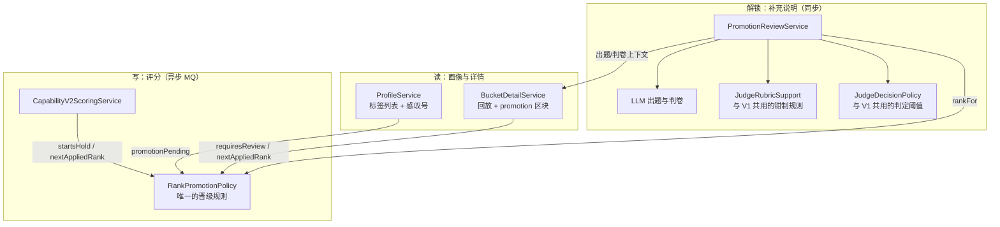
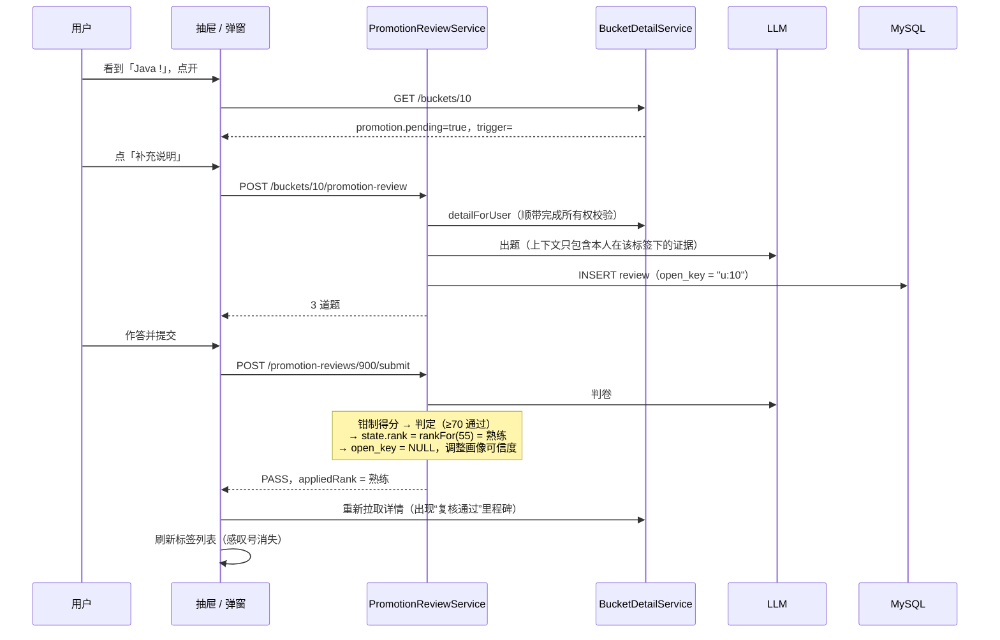

# Stage 15.1：晋级复核与补充说明

> 一句话：有标签被“卡住晋级”时，标签上会亮起黄色感叹号。用户点开就能看到是哪条经历卡住了它；点“补充说明”后，LLM 会围绕这段经历问 3 个问题，答好了阶段会直接升到当前分数对应的位置。整个过程只决定“阶段”，不增减任何分数。

这次做了两件事：

1. **修一个设计缺陷**：“待复核”会永久锁死阶段。
2. **加一个功能**：补充说明，也就是复核的出口。

先修缺陷，再加功能，顺序不能反。如果规则本身会自我锁死，补再多出口也只是在给 bug 打补丁。

---

## 1. 问题：为什么原来会“永久锁死”

原来的规则分散在两个地方：

- **评分公式**（`AbilityScoreCalculator`）：只要 `state 里的阶段 ≠ 分数对应的阶段`，并且目标阶段 ≥ 成长中，就打上 `RANK_PROMOTION_REQUIRES_JUDGE` 标记。
- **评分服务**：只要有任何标记，证据就设为 `REVIEW_REQUIRED`，阶段冻结。

两条规则单独看都合理，合在一起就出了问题：

```
第 1 条证据：28 → 33 分，应升「成长中」→ 打标记 → 冻结在「基础」
第 2 条证据：33 → 36 分，state 仍是「基础」≠「成长中」→ 又打标记 → 继续冻结
第 3 条证据：……永远如此
```

**根因**：冻结的结果（state 阶段落后）又被当成了下一次冻结的输入。这是一个**正反馈回路**。系统没有记住“我已经在等复核了”，于是每一条新证据都会重新发现同一个问题。

另一个问题是：“证据可疑”（例如单次加分过大）和“晋级需要把关”这两种完全不同的风险共用了一个状态。前者实际上什么都没拦住，后者拦住了晋级，用户却看不出区别。

---

## 2. 架构位置



核心变化是把**原本散落在三处的晋级规则**收拢成一个 `RankPromotionPolicy`，让写入、读取回放、解锁三条路径调用同一份代码。Stage 15 的报告里提到过“规则写了两份”这个技术债，这次一并解决了。

---

## 3. 关键设计决策

### D1：把“冻结”建模成标签的状态，而不是证据的状态

| | 旧模型 | 新模型 |
| --- | --- | --- |
| 什么是“待复核” | 每条证据各自的状态 | 标签处于“等待晋级”的状态 |
| 怎么判断 | 看证据的 status | `rankFor(当前分数)` 是否高于 state 中的阶段，并且需要把关 |
| 证据上的标记 | 每条后续证据都是 `REVIEW_REQUIRED` | 只有**开启冻结**的那一条是 |

判断某条证据是否开启了冻结，只需要比较它计分前后的状态：

```java
startsHold = !pending(当前阶段, 旧分数) && pending(当前阶段, 新分数)
```

这是一个**边沿触发**（edge-triggered），而不是**电平触发**（level-triggered）。电子电路里的这两个概念在这里完全适用：

- 电平触发：只要处于高电平就一直触发。旧规则就是这样，每条证据都会触发。
- 边沿触发：只在从低到高的那一刻触发一次。新规则只在冻结开始时触发。

“是否待晋级”完全可以从 state 一行数据推导出来，所以画像接口给每个标签加感叹号，**不需要多查任何一张表**。

### D2：复核记录在用户点击时才创建，而不是在评分时创建

- **备选方案**：
  - (a) 评分开启冻结时，在同一个事务里创建复核记录（V1 就是这么做的）。
  - (b) 用户点击“补充说明”时才创建。
- **选择**：(b)。
- **理由**：
  1. **写链路几乎不用改**。评分走的是 MQ 异步链路，那里要处理幂等、重试和并发。在那里多写一张表，就要多考虑一组失败场景。
  2. **历史数据不用迁移**。上线前就已经被锁死的标签没有复核记录，但“是否待晋级”是推导出来的，它们会自动亮起感叹号，点一下就能走新流程。如果选 (a)，还得写一段数据回填。
  3. **不浪费 LLM 调用**。出题要调模型，很多被冻结的标签用户可能根本不会点开。
- **代价**：开启冻结的是哪条证据，需要在读取时通过回放算出来。不过 Stage 15 的回放本来就存在，几乎没有额外成本。

### D3：用唯一索引保证“同一标签只有一个进行中的复核”

用户双击按钮，或者开着两个标签页，都可能并发发起两次复核。做法是：

```sql
open_key VARCHAR(140)  -- 进行中时为 "userId:bucketId"，完成后置为 NULL
CONSTRAINT uk_... UNIQUE (open_key)
```

MySQL 的唯一索引允许多个 NULL，所以：

- 进行中的复核：最多一条，由数据库保证；
- 已完成的复核：可以有任意多条，作为历史保留。

这是实现“**部分唯一索引**”（PostgreSQL 写作 `UNIQUE ... WHERE status = 'IN_PROGRESS'`）的 MySQL 惯用手法。相比“先查一下有没有，再插入”，它没有竞态窗口：两个请求同时通过了检查，只有一个能插入成功。

### D4：复核只决定阶段，不碰分数

用户回答的内容**不会**变成加分来源。原因是：

- 如果补充说明能加分，它就成了一个刷分入口：每次答题都能涨分。
- 分数应该只来自真实完成的经历，这条原则从 Stage 00 就定了：LLM 不直接决定分数。
- 复核回答的只是一个是非题：这个分数配不配得上这个阶段？

单元测试里有一条断言专门守住这一点：复核通过后，能力分保持 55 不变。

### D5：通过后直接升到当前分数对应的阶段（你拍板的规则）

冻结期间分数可能继续上涨，比如从 33 涨到了 55。通过复核后：

- **直接升到 55 分对应的「熟练」**，而不是只升一级到「成长中」。
- **理由**：题目是基于这个标签下**全部**证据出的，验证的就是当前的整体水平。如果每次只升一级，用户就得为同一批证据反复答题。
- **实现**：`state.rank = rankFor(提交那一刻的分数)`。注意用的是**提交时**的分数，而不是发起复核时的分数，因为答题期间可能又有新证据入账。

### D6：防止反复重试，但不惩罚“系统自己的失败”

| 上次结果 | 能否再发起 |
| --- | --- |
| 通过 | 不需要再发起（已经不再待晋级） |
| 不通过，或分数在 50–69 之间暂不下结论 | 补充一段新的经历，**或者**等 7 天 |
| 模型不可用 | **立刻**可以重试 |

- **为什么要冷却期**：没有冷却期的话，用户可以不停重答，直到 LLM 判通过为止。这等于对判卷模型做暴力破解。
- **为什么“新经历”可以绕过冷却期**：冷却的目的是防止对**同一批证据**反复试探。有了新经历，证据集合变了，重新验证是合理的。
- **为什么模型故障不计入**：失败是系统造成的，不是用户造成的。复核记录里存了 `model_evaluated` 字段，专门用来区分这两种情况。

这条规则写在 `CapabilityPromotionReviews.retryAvailableAt` 里。它是一个纯函数，详情接口（决定按钮显示什么）和复核服务（决定是否放行）调用的是同一个函数，所以前端看到的和后端执行的不会不一致。

### D7：出题的优先级，以及为什么它同时是防作弊手段

```
q1、q2：围绕你的经历。题干必须点名具体经历，优先使用开启冻结的那一条
q3：相关延伸问题。知识标签偏原理与迁移，职能标签偏职责、交付与协作
```

**为什么经历题排在前面**：

- 通用问题（例如“讲讲 Spring 事务”）拿去问 ChatGPT 很容易答出来；
- 但“你在订单项目里那个接口为什么这么拆”，只有真正做过的人才说得清。
- 判卷提示词要求 q1、q2 检查**回答与证据是否一致**，自相矛盾或明显编造时给低分。

所以“围绕经历出题”不只是体验上更友好，它本身就是一层防作弊设计。

**模型输出不可直接信任**：

- 题目经过 `sanitizeQuestions` 处理：截断长度、重新编号、固定为 3 道题、每题满分 10 分。
- 判分经过 `sanitizeRubric` 处理：每题得分钳制在 0 到满分之间，并且**忽略模型自报的总分，重新计算**。
- 模型不可用时，用模板题兜底，模板题同样会点名触发冻结的那段经历。

### D8：抽取 V1 的代码，而不是复制一份

V1 Judge 原本把答案校验、题目清洗、判分钳制写在 `JudgeAssessmentService` 的私有方法里。这次把它们抽成了 `JudgeRubricSupport`，V1 和 V2 共用。

- **怎么证明重构没有改变 V1 的行为**：V1 已有的 `JudgeAssessmentServiceTest` 原样通过。
- **为什么值得多做这一步**：这些都是“怎么约束 LLM 输出”的规则。以后如果发现模型绕过了某个约束，只需要修一处。

---

## 4. 一次完整的补充说明



每次出题和判卷都会通过 `AgentRunService` 写入 trace，复用 V1 的 `ABILITY_JUDGE` 类型和 `JUDGE_*` 步骤。出现 bad case 时，可以在 Agent 日志里看到当时的输入和结果。

---

## 5. 前端

- **标签上的感叹号**：一个黄色小圆点，内容是 “!”，同时补充了 `aria-label` 和 `title`。最强标签带有星光边框，这个边框是用伪元素叠在上面的，所以感叹号需要单独设置 `z-index`，否则会被盖住。
- **抽屉顶部的横幅**：写明“分数够了，阶段还停在哪里”，提供“查看是哪条经历”（滚动到对应证据）和“补充说明”按钮；在冷却期内，按钮会换成等待提示。
- **证据卡片的状态**：
  - “卡住晋级”（黄色，带按钮）：只有开启冻结的那一条。
  - “已通过复核”（蓝色）。
  - 其余都显示为“已计分”。旧数据里那些被误标为 `REVIEW_REQUIRED` 的证据，对用户来说同样只显示“已计分”。
- **答题弹窗**：每道题会标明是“你的经历”还是“相关延伸”，提醒用户答题的重心。结果页明确告诉用户“分数没变，只是阶段解锁了”。
- **层级与按键**：弹窗通过 Teleport 挂到 body 下，z-index 比抽屉高；按 Esc 只关闭最上面的一层。
- **提交后的刷新**：先重新拉取详情，再通知页面静默刷新标签列表。静默刷新不会重放开场的打字机动画。

---

## 6. 怎么证明它是对的

| 测试类 | 覆盖的内容 |
| --- | --- |
| `RankPromotionPolicyTest`（4 个用例） | 只有晋级到“成长中”及以上才需要复核；从不降级；只有跨入冻结的那一刻才触发；“是否待晋级”只看 state |
| `CapabilityV2BucketDetailServiceTest`（6 个用例） | 后续证据不会重复开启冻结；通过的复核会被回放为阶段变化；对账成立；冷却期生效；模型故障可以立即重试；“晋级需复核”标记不会出现在每条证据上 |
| `CapabilityV2PromotionReviewServiceTest`（7 个用例） | 只能有一个进行中的复核；模板题点名触发冻结的经历；恢复进行中的复核不调用模型；**通过后从「基础」直接升到「熟练」且分数不变**；不通过时阶段不变、画像可信度下降；模型不可用时不改任何数据；看不到别人的复核 |
| `CapabilityV2ProfileServiceTest` | 感叹号由 state 推导得出 |
| `JudgeAssessmentServiceTest`（V1 原有） | 重构后 V1 行为不变 |

后端全量 Maven 测试通过，前端 `vue-tsc` 类型检查和生产构建也都通过。

**没有覆盖的部分**：

- 没有在真实 MySQL 上执行 V27，也没有在浏览器里走过完整流程。验收步骤写在 `当前待办.md` 里。
- 出题和判卷的**质量**没有自动化评估：问题是否真的点名了经历、判分是否公允，需要 Stage 16 的 Golden Set 来度量。

---

## 7. 已知边界

| 项 | 说明 |
| --- | --- |
| 并发发起复核 | 唯一索引能保证正确性，但两个请求同时插入时，失败的那个会收到 500，而不是友好提示。前端在请求期间禁用了按钮，所以实际很难触发。如有需要，可以捕获 `DataIntegrityViolationException` 并返回已存在的复核。 |
| 分数 50–69 的“暂不下结论” | 和 V1 一样，目前没有人工复核界面，效果等同于“未通过”，进入冷却期。 |
| 不通过会降低画像可信度 | 沿用 V1 的规则。画像可信度会影响后续评分，所以一次失败会产生轻微的长期影响。这是有意保留的“诚实信号”，但值得在 Golden Set 阶段观察是否过于严厉。 |
| 旧数据的边缘情况 | 旧规则下，从 UNRATED 升到 FOUNDATION 时如果带有其他疑点标记，也会被冻结。新规则不再冻结这一级，所以这类旧标签的对账可能显示不一致。下一条证据计分时会自动纠正。 |

---

## 8. 可迁移的模式

1. **边沿触发，而不是电平触发**：任何“发现问题就标记”的规则，都要问一句：标记本身会不会让下一次检查再次命中？
2. **单一规则源**：同一条业务规则如果被写入、读取、解锁三处使用，就必须是同一段代码，否则迟早会出现漂移。
3. **推导状态，而不是存储状态**：“是否待晋级”从 state 一行就能算出来，就不要再另存一个字段，避免它和真实状态不一致。
4. **用唯一索引表达业务不变量**：“最多一个进行中的复核”交给数据库保证，而不是靠“先查后写”。
5. **LLM 负责提议，确定性代码负责裁决**：模型出题、模型判分，但数量、范围、总分和判定阈值都由 Java 决定。
6. **区分用户失败和系统失败**：模型故障不应该消耗用户的重试机会。

**面试时可以这么讲（STAR）**：

> **S**：能力标签的晋级需要复核，但系统上线后发现，一个标签只要被拦下一次，之后的每一条证据都会再次被拦，阶段被永久锁死。
> **T**：修复这个锁死问题，并给用户一个解锁的出口。
> **A**：我先定位到根因：冻结的结果被当成了下一次冻结的输入，形成正反馈。于是把规则收拢成一个共享的 `RankPromotionPolicy`，把“待复核”从证据级的电平触发改成标签级的边沿触发。在此基础上加了补充说明流程：复核记录在用户点击时才创建，这样写链路和历史数据都不用改；用唯一索引保证同一标签同时只有一个进行中的复核；题目优先围绕用户本人的经历出，这同时起到防作弊的作用；复核只解锁阶段、不改分数；不通过要等新经历或冷却期才能再试，模型故障则不计入。
> **R**：卡住的标签能被用户自己解开；评分、回放、解锁三条路径共用同一份规则；V1 的判卷护栏被抽取出来复用，V1 原有测试全部通过。

---

## 9. 文件清单

**后端** `do-not-miss-backend`：

- 新增 `capabilityv2/RankPromotionPolicy.java`：唯一的晋级规则。
- 新增 `capabilityv2/CapabilityPromotionReviewEntity.java` 和 `CapabilityPromotionReviewRepository.java`。
- 新增 `capabilityv2/CapabilityPromotionReviews.java`：复核视图和重试规则。
- 新增 `capabilityv2/CapabilityV2PromotionReviewService.java` 和 `CapabilityV2PromotionReviewController.java`。
- 新增 `abilityscore/JudgeRubricSupport.java`：从 V1 抽取的判卷护栏。
- 新增 `resources/db/migration/V27__add_capability_v2_promotion_reviews.sql`。
- 修改 `capabilityv2/CapabilityV2ScoringService.java`：边沿触发冻结，阶段规则改为调用 policy。
- 修改 `capabilityv2/CapabilityV2BucketDetailService.java`：回放纳入复核事件，新增 `promotion` 区块，过滤重复的晋级标记。
- 修改 `capabilityv2/CapabilityV2ProfileService.java`：新增 `promotionPending` 和 `pendingRank`。
- 修改 `abilityscore/JudgeAssessmentService.java`：改为调用 `JudgeRubricSupport`。
- 测试：新增 `RankPromotionPolicyTest` 和 `CapabilityV2PromotionReviewServiceTest`；更新详情、画像、评分三个测试类。

**前端** `do-not-miss-frontend`：

- 新增 `components/achievements/PromotionReviewDialog.vue`。
- 修改 `components/achievements/CapabilityBucketDetailDrawer.vue`：横幅、卡住的证据、复核历史、弹窗编排。
- 修改 `views/StudentAchievementsView.vue`：感叹号、复核后静默刷新。
- 修改 `api/achievements.ts`、`types/achievements.ts` 和 `styles/main.css`。
