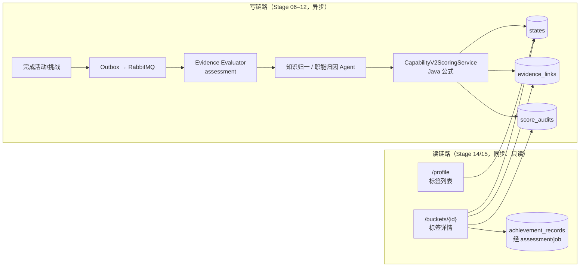
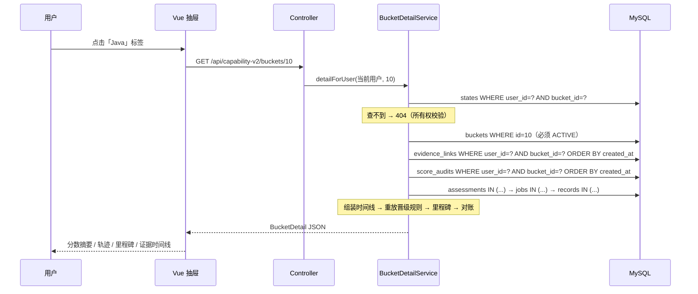

# Stage 15：标签详情与里程碑

> 一句话：点开任意一个能力标签，系统用“已经落库的证据链接 + 评分审计”重放出这个分数的形成过程，回答“这个能力为什么是这个分”。整个过程只读，不调用 LLM，也不改任何数据。

---

## 1. 先对一下你的理解

你的理解是：“标签本身是 LLM 参考活动证据拿到的，标签一出现就绑定了库里的证据，所以要做的其实就是一个简单的查询加展示。”

**大方向是对的**，而且这正是前面阶段设计得好的地方：Stage 11/12 在**写入时**就把每一次加分拆成了三份记录：

| 表 | 记录了什么 |
| --- | --- |
| `user_capability_v2_states` | 当前结果：经验、能力分、阶段、证据数 |
| `capability_v2_evidence_links` | 哪条经历归入了这个桶：相关度、角色、事实点、状态 |
| `capability_v2_score_audits` | 这次加了多少分、加分前后的值，以及完整的公式输入快照 |

因为写入时已经把“结果 + 原因”都存下来了，读的一侧才能这么简单。这在架构上叫**写时物化**（write-time materialization）：把计算和解释的成本放在写入链路，读链路只做拼装。

**但“简单查询”里藏着 5 个坑**，这也是这次实现真正花心思的地方：

1. **证据链接并不直接指向成长记录。** `evidence_links.source_id` 存的是活动 ID 或挑战 ID，不是 `achievement_record.id`。要拿到“活动标题、我做了什么、我学到了什么”，得沿着 `legacy_assessment_id → assessment.job_id → job.achievement_record_id` 走三跳。
2. **“为什么是这个分”不在链接表里，而在审计表的 JSON 快照里。** 难度、完成质量、贡献、新颖度等因子都存在 `factor_snapshot_json` 中，需要解析和挑选。
3. **阶段（rank）不等于“按分数查表”。** 评分服务有一条规则：证据被标记为待复核时，**分数照加，但阶段晋级被冻结**。所以不能直接拿 `rankFor(newScore)` 判断“哪次晋级了”，必须按评分顺序完整重放这条规则。
4. **bucketId 不能当作权限。** 职能桶是 372 个全局共享桶，所有用户共用同一个 bucketId。如果只按 bucketId 查，就可能读到别人的数据。
5. **里程碑在库里根本不存在。** 要么新建一张表存里程碑，要么在读取时推导出来，这是一个需要做的架构选择。

---

## 2. 它在系统里的位置



这其实就是一个轻量的 **CQRS**（命令查询职责分离）：

- **写模型**：复杂、异步、涉及 LLM，负责保证幂等和正确性。
- **读模型**：简单、同步、确定性，只负责解释。

两边通过表结构（也就是数据契约）解耦。Stage 15 完全没有改写链路的任何一行代码。

---

## 3. 关键设计决策

### D1：读接口绝不触发 LLM 或重算

- **问题**：打开详情页时，要不要顺便“刷新一下”分数或让模型生成解释？
- **选择**：不要。详情页只读库。
- **理由**：
  - 解释必须和当时真实执行的计算**一致**。如果读的时候再让 LLM 生成一遍，同一个分数可能每次给出不同的理由，可解释性就失效了。
  - 读路径的延迟和成本都要可预测。
- **体现**：Service 上标注了 `@Transactional(readOnly = true)`，并且整个服务没有注入任何 Agent 或 LLM 客户端。

### D2：用“自己的 state 行”证明所有权

- **问题**：`GET /buckets/{bucketId}` 如何防止越权？
- **备选方案**：
  - (a) 检查 `bucket.owner_user_id == 当前用户`。但职能桶的 owner 是 `__GLOBAL__`，这个检查对职能桶不成立。
  - (b) 所有查询都带上 `user_id` 条件。
  - (c) 先查 `states(user_id, bucket_id)`，查不到就返回 404。
- **选择**：(c) + (b)。先用 state 行证明“这个用户确实拥有这个桶的分数”，后续每一个查询也都带 `user_id`，做纵深防御。
- **细节**：在补齐成长记录时，还会校验 `job.userId` 和 `record.userId` 是否等于当前用户。测试里专门构造了“job 属于别人”的情况，断言标题不会被泄露。
- **为什么返回 404 而不是 403**：返回 403 会告诉调用者“这个 ID 存在，只是你没权限”，这本身就泄露了信息。

### D3：证据到成长记录的关联方式

- **问题**：怎么从 evidence link 找到活动标题和心得？
- **备选方案**：
  - (a) 解析审计快照 JSON 里的 `capabilityV2EvidenceId = "achievement-record:123"`。只要一跳，但依赖字符串格式，属于“字符串类型的外键”。
  - (b) 沿真实外键链走 `assessment → job → record`。要三跳，但每一跳都是有类型的列。
  - (c) 加一个迁移，给 `evidence_links` 增加 `achievement_record_id` 冗余列。最快，但要改写链路，还要回填历史数据。
- **选择**：(b)。不改写链路，也不依赖字符串格式。
- **性能**：三跳都用 `findAllById(批量 ID)`，所以无论时间线有多少条，都**固定是 3 次查询**，避免了 N+1 问题。
- **以后什么时候改成 (c)**：如果详情页成为热点、或者出现更多需要“证据 → 记录”的场景，就值得加冗余列，同时在写链路里填上它。

### D4：里程碑在读取时推导，不落库

- **问题**：“第一次点亮 / 晋级 / 最大单次成长”存在哪里？
- **备选方案**：
  - (a) 新建 `capability_v2_milestones` 表，评分时同步写入。
  - (b) 每次读取时，从审计记录重放推导。
- **选择**：(b)。
- **理由**：
  - 里程碑是审计历史的**纯函数**。存一份派生数据，就多了一个可能和真相不一致的副本。
  - 规则会演进。比如以后想加“连续 3 周成长”这类里程碑，(b) 改代码就能对所有历史生效；(a) 还得写数据回填。
  - 一个桶的证据量在几十条以内，重放成本可以忽略。
- **这就是事件溯源（Event Sourcing）的思路**：审计表就是事件流，state 是当前快照，里程碑是对事件流的一次投影（projection）。
- **什么时候该落库**：证据量到了上千条、需要跨用户查询（例如“本周晋级的人”），或者里程碑要触发通知时。

### D5：晋级规则的“精确重放”

评分服务里的规则（`CapabilityV2ScoringService.applyOutput`）是：

```
if (状态 != 待复核 || 旧阶段 == 新提议阶段) → 阶段 = 新提议阶段
否则 → 阶段保持不变（冻结）
```

详情服务按评分顺序维护一个 `appliedRank` 变量，逐条套用完全相同的规则：

| 证据 | 状态 | 能力分 | 提议阶段 | 实际阶段 | 产生的里程碑 |
| --- | --- | --- | --- | --- | --- |
| #1 | 已计分 | 0 → 12 | 基础 | 基础 | 第一次点亮、晋级「基础」 |
| #2 | 待复核 | 12 → 33 | 成长中 | **基础（冻结）** | 「成长中」待复核 |
| #3 | 已计分 | 33 → 36 | 成长中 | 成长中 | 晋级「成长中」 |

如果偷懒直接用“分数跨过阈值”来判断，会在 #2 处显示“晋级成长中”，这和用户档案里显示的阶段**矛盾**。上面这张表就是单元测试里的场景。

> **更正（2026-10-19）**：上表第 3 行在**现有评分规则下实际不会发生**，它只用来验证重放逻辑本身是否正确。
>
> 原因：第 3 条证据计分时，评分引擎拿 state 里冻结的阶段（基础）和提议阶段（成长中）比较，两者不一致，于是会**再次**触发 `RANK_PROMOTION_REQUIRES_JUDGE`，这条证据同样是“待复核”，阶段继续冻结。
>
> 真实行为是：一个标签的能力分只要越过 30 分并被拦下，之后它的每一条证据都会是“待复核”，阶段永久停在“基础”，直到有复核出口为止。详见第 7 节。
>
> 详情服务的重放结果仍然和数据库一致，因为两边用的是同一条规则；有问题的是规则本身缺少出口。

- **阈值复用**：直接注入 `AbilityScoreCalculator` 并调用它的 `rankFor`，避免在两处各写一套 10/30/50/70/85 的阈值。
- **技术债**：“冻结规则”目前仍然在评分服务和详情服务里各写了一份（见第 7 节）。

### D6：接口自带对账（reconciliation）

接口会返回一个 `consistency` 对象：

```json
{
  "explainedExperience": 15.0,
  "stateExperience": 15.0,
  "experienceReconciled": true,
  "replayedRank": "DEVELOPING",
  "rankReconciled": true
}
```

- **含义**：
  - 时间线上所有经验增量之和，应该等于 state 里的经验值。
  - 重放得到的阶段，应该等于 state 里的阶段。
- **为什么要做**：这是“可解释系统”的自检。如果两边对不上，说明存在没被审计覆盖的写入，比如未来 Stage 13 的正式迁移写入、手工修数据，或者某个 bug。前端会把这种情况显示成黄色提示，而不是悄悄展示一个自相矛盾的页面。
- **可迁移的模式**：财务系统里的“流水之和 = 余额”就是同一个道理。只要存在“快照 + 流水”两份数据，就应该有对账。

### D7：后端返回事实，前端负责文案

- 第一版曾经在后端拼了 `"晋级 DEVELOPING"` 这样的文案，后来改掉了。现在里程碑只返回 `type / fromRank / toRank / experienceGain`，由前端映射成「晋级“成长中”」。
- **理由**：
  - 本地化和文案调整不应该需要改后端、重新发版。
  - 结构化字段还能复用到别的场景，比如简历生成、企业视图。

### D8：为读模式补索引（Flyway V26）

- **原有索引**：`(user_id, created_at)` 和 `(bucket_id, created_at)`。
- **问题**：职能桶是全局的，`bucket_id = 后端开发` 会命中**所有用户**的行，再逐行过滤 `user_id`；随着用户增长会退化。
- **处理**：新增 `(user_id, bucket_id, created_at)` 联合索引。等值列在前、排序列在后，可以直接按索引顺序返回结果，省掉排序。
- **注意**：JPA 是 `ddl-auto: validate`，结构由 Flyway 管理。实体上的 `@Index` 只是同步文档，真正生效的是 `V26__index_capability_v2_bucket_detail.sql`。

---

## 4. 一次请求的完整路径



一次请求固定 **7 次 SQL**，与证据条数无关。

---

## 5. 前端实现要点

- **组件拆分**：新建 `components/achievements/CapabilityBucketDetailDrawer.vue`，没有继续往已经 570 行的 `StudentAchievementsView.vue` 里堆代码。页面只负责持有 `selectedBucket` 状态和打开抽屉。
- **竞态处理**：用户快速连续点击两个标签时，先发出的请求可能后返回。代码里用 `requestSeq` 序号，只接受最新一次请求的结果。这是异步 UI 的经典问题，最常见的表现是“看着 Java，内容却是 MySQL”。
- **交互**：
  - 点击里程碑会滚动并高亮对应的证据卡。
  - 能力分轨迹用一条手写 SVG polyline 实现，没有为一条折线引入图表库。
  - 评分因子放在 `<details>` 里默认收起，保持首屏可扫描。
- **可访问性**：
  - 标签从 `<span>` 改为 `<button>`，键盘可以聚焦，并带 `aria-label`。
  - 抽屉带 `role="dialog"`，支持 Esc 键关闭。
  - 尊重系统的 `prefers-reduced-motion` 设置，关闭动画。
- **移动端**：抽屉宽度是 `min(560px, 100%)`，手机上占满屏幕；评分摘要从 4 列降为 2 列。

---

## 6. 怎么证明它是对的

**单元测试** `CapabilityV2BucketDetailServiceTest` 共 3 个用例：

1. **主场景**：3 条有效证据加 1 条被取代（SUPERSEDED）的证据，验证：
   - 被取代的证据不展示；
   - 外键链正确补出标题，而属于别人的 job **不会**泄露标题；
   - judgeFlags 和评分因子能从 JSON 快照中正确解析；
   - 里程碑的类型、顺序都正确，并且“晋级冻结 → 下一次干净计分时补晋级”这条规则被正确重放；
   - 两项对账都成立。
2. **越权**：用户没有这个桶的 state 时返回 404，并且断言**证据表和审计表完全没有被查询**（`verifyNoInteractions`）。
3. **停用的桶**返回 404。

**构建验证**：

- 后端 Maven 全量测试通过。
- 前端 `vue-tsc` 类型检查和 `vite build` 通过。

**没有覆盖的部分（需要人工验收）**：

- 没有在真实 MySQL 上跑过（V26 迁移会在下次启动后端时执行）。
- 没有在浏览器里点过真实数据。
- Repository 的派生查询方法名由 Spring Data 在启动时校验，单测用的是 mock，只有启动后端才能证明这些方法名是合法的。

---

## 7. 已知边界与后续

| 项 | 现状 | 建议 |
| --- | --- | --- |
| **“待复核”没有出口，且会永久卡住** | V2 评分把证据标为 `REVIEW_REQUIRED` 后冻结晋级，但**不会创建 Judge 任务**（V1 会调用 `judgeAssessmentService.createIfRequired`，V2 没有）。更严重的是，冻结之后 state 里的阶段和提议阶段始终不一致，“晋级需复核”会被**每一条后续证据重复触发**：一个标签过了 30 分，阶段就会永远停在“基础”，后续证据也全部是“待复核”。 | **已在 Stage 15.1 解决**：冻结改为边沿触发，并新增“补充说明”复核出口。 |
| 晋级规则写了两份 | 评分服务和详情服务各实现一次“冻结规则”。 | **已在 Stage 15.1 解决**：抽出 `RankPromotionPolicy`，评分、回放、解锁三处共用；“永久卡住”的问题也一并修复。见 [Stage15.1_晋级复核与补充说明.md](Stage15.1_晋级复核与补充说明.md)。 |
| 不分页 | 一次返回一个桶的全部证据。 | 证据超过约 200 条后，改为游标分页；里程碑改成增量计算或落库。 |
| 迁移数据会导致对账失败 | Stage 13 如果做正式迁移写入却不生成审计，对账会显示为黄色。 | 正式迁移时为每个迁移桶写一条 `MIGRATION` 类型的审计。 |
| 心得更新后的更正 | 幂等键刻意不包含心得哈希，更新心得不会重新计分。 | 后续“更正 / 回放”流程应该把旧审计标为 SUPERSEDED，再写新审计；详情页已经会过滤 SUPERSEDED。 |

---

## 8. 可迁移的模式和面试表达

**这次用到的 5 个通用模式**：

1. **写时物化，读时拼装**：复杂度放在异步写链路，读链路保持确定和廉价。
2. **派生数据不落库，从事件流投影**：里程碑是审计流的纯函数。
3. **快照 + 流水必须对账**：`Σ 增量 = 当前值`，同时作为系统自检和用户信任的依据。
4. **所有权由“关系”证明，而不是由“ID”证明**：全局共享资源尤其要注意。
5. **批量加载外键链，避免 N+1**：查询次数固定，不随数据量增长。

**面试时可以这么讲（STAR）**：

> **S**：能力标签由 LLM 归因、Java 引擎计分，用户只能看到一个数字，不信任这个分数。
> **T**：让用户点开任意标签，就能看到这个分数是怎么来的。
> **A**：因为写链路在评分时已经把每一次加分落成了“证据链接 + 公式输入快照”，我在读侧做了一个只读投影：用用户自己的状态行校验所有权，用三次批量查询补齐原始经历，再按评分顺序重放晋级规则，推导出里程碑。重放时特别处理了“分数照加但晋级冻结”的复核规则，并且在接口里加入对账字段，让“证据增量之和等于当前分”成为一个可以自动验证的不变量。
> **R**：详情接口不调用模型、查询次数固定为 7 次；每个分数都能追溯到具体的经历、事实点和公式输入；一旦出现没被审计覆盖的写入，前端能立刻显示不一致提示。

---

## 9. 文件清单

**后端** `do-not-miss-backend`：

- 新增 `capabilityv2/CapabilityV2BucketDetailService.java`：详情读模型、重放、里程碑和对账。
- 修改 `capabilityv2/CapabilityV2ProfileController.java`：新增 `GET /buckets/{bucketId}`。
- 修改 `capabilityv2/CapabilityEvidenceLinkRepository.java` 和 `CapabilityScoreAuditRepository.java`：新增按 `user + bucket` 查询的方法。
- 修改 `capabilityv2/CapabilityEvidenceLinkEntity.java` 和 `CapabilityScoreAuditEntity.java`：同步索引声明。
- 新增 `resources/db/migration/V26__index_capability_v2_bucket_detail.sql`。
- 新增测试 `capabilityv2/CapabilityV2BucketDetailServiceTest.java`。

**前端** `do-not-miss-frontend`：

- 新增 `components/achievements/CapabilityBucketDetailDrawer.vue`。
- 修改 `views/StudentAchievementsView.vue`：标签改为按钮，接入抽屉。
- 修改 `api/achievements.ts` 和 `types/achievements.ts`：新增接口和类型。
- 修改 `styles/main.css`：新增 Stage 15 抽屉样式。

**文档**：

- `do-not-miss-docs/当前待办.md`：Stage 15 完成情况与人工验收项。
