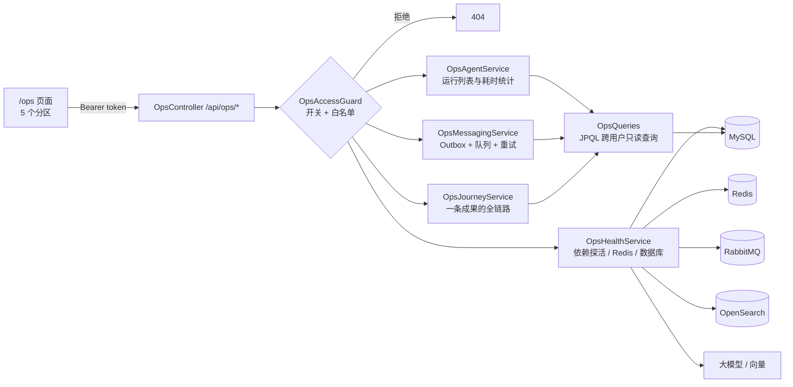
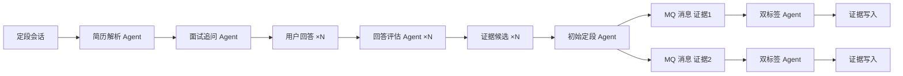

# 方向 A：运维观测面板（Ops Console）

> 一句话：之前想知道“这条成果为什么没入账”“消息卡在哪”“Agent 哪一步慢”，只能连上 MySQL 手写 SQL、开 RabbitMQ 管理台、翻后端日志。现在有一个 `/ops` 页面，**一页同时看 SQL、Redis、消息队列、Agent、大模型五层**，还能按“一条成果”把这几层串成一条时间线。
>
> **状态（2026-10-23）**：后端 + 前端已完成。Maven 全量 134 个测试通过（新增 12 个），`npm run build` 通过；在真实环境（本地 Docker 的 MySQL / Redis / RabbitMQ / OpenSearch + DeepSeek）里调用了全部接口并检查了页面（待人工验收）。对应 Backlog 第 11、12 条。

---

## 1. 面板包括哪些部分

| 分区 | 覆盖的层 | 能回答的问题 |
| --- | --- | --- |
| **总览** | MySQL、Redis、RabbitMQ、OpenSearch、对话模型、向量模型 | 现在哪个依赖挂了 / 降级了？延迟多少？有没有卡住的运行、重试耗尽的消息？ |
| **链路追踪** | SQL → MQ → Agent → SQL | 某个用户完成的某条活动/挑战，走到了哪一步、在哪一步失败、为什么？ |
| **Agent 运行** | Agent | 各类 Agent 跑了多少次、失败多少、平均 / P95 耗时；双标签链路 6 个步骤哪步最慢；单次运行的每步输入输出和模型原始输出（trace 产物） |
| **消息队列** | Outbox 表 + RabbitMQ | 队列有没有积压、有没有消费者；Outbox 里哪些消息在延后重试、哪些重试耗尽；一键重新投递 |
| **Redis / 数据库** | Redis、MySQL | 键空间按前缀的数量与内存；连接池使用 / 排队；Flyway 迁移历史；各表大小 |

总览里的计数卡片可以直接点，跳到对应分区。

---

## 2. 架构位置

新代码全在 `ops` 包里，**只读**现有表，唯一的写操作是“消息重新投递”。业务代码只改了两处：`AgentRunService` 加了一个不按用户过滤的 `detailForOps`，`FunctionBucketSemanticIndex` 加了一个只读的 `status()`。

---

## 3. 关键设计决策

### D1：访问控制——开关 + 白名单，拒绝时返回 404

**问题**：面板能看到所有用户的数据（Agent 输入、成果标题、消息载荷），但项目里只有 STUDENT / SOCIAL 两种角色，没有 ADMIN。

**选项**：
1. 新增 ADMIN 角色：需要改表、改注册、改前端路由守卫，是一个独立的权限项目（Backlog 13）。
2. 环境变量开关 + 用户 ID 白名单：`OPS_CONSOLE_ENABLED`（默认 false）+ `OPS_ADMIN_USERS`。

**选择**：2。默认关闭，生产环境不配置就等于不存在。拒绝时返回 **404 而不是 403**：403 等于告诉别人“这里有东西，只是你没权限”，404 不暴露面板的存在。

**代价**：白名单写在配置里，改名单要重启。等真正做权限体系时，把 `OpsAccessGuard.allowed()` 换成角色判断即可，其他代码不用动。

### D2：每个依赖独立探活，一个挂了不影响其他

**问题**：总览要同时连 6 个依赖。如果 Redis 挂了导致整个接口 500，面板就在最需要它的时候失效。

**选择**：每个探针包在 `probe()` 里，异常变成一张 DOWN 卡片，并取异常链最底层的原因（例如 `Connection refused`，而不是外层的 Spring 包装异常）。计数器同理，取不到就不显示，不让整个接口失败。

### D3：大模型只看配置，不自动调用

**问题**：探活应该真的调一次模型吗？

**选择**：打开总览时只读配置（mock 还是真实模型、是哪个模型），**不花额度**；另外提供“实测模型连通”按钮，点击时才分别给对话模型和向量模型发一个极小请求，返回真实延迟。原因是总览可能被频繁刷新，每次都调模型既花钱，又会把模型延迟混进页面加载时间。

### D4：链路追踪怎么把四张表串起来

**问题**：一条成果会经过 `achievement_records` → `domain_event_outbox` → `agent_runs` → `ability_assessment_jobs` → `domain_event_outbox` → `agent_runs` → `capability_v2_evidence_links`，但这些表之间**没有外键链**。

**做法**：利用已有的“弱关联”：

| 环节 | 怎么找到它 |
| --- | --- |
| Outbox 消息 | 载荷 JSON 里的 `recordId`（MySQL 输出 JSON 的格式是 `"recordId": 23,` 或 `"recordId": 23}`，用两个 LIKE 匹配） |
| Agent 运行 | Agent 启动时写的 `input_summary` 以 `recordId=23,` 开头（正则解析） |
| 评估任务 | `ability_assessment_jobs.achievement_record_id`（真外键） |
| 证据写入 | V28 加的 `capability_v2_evidence_links.agent_run_id` |

然后按时间排序，并给出一句结论。结论的优先级是：**任何一环失败 > 还在处理或等待重试 > 已入账**。

**代价**：依赖 `input_summary` 的文本格式，是一种隐式约定。如果以后有人改了 Agent 的 inputSummary 写法，链路追踪会悄悄断开。更稳的做法是给 `agent_runs` 加一个 `correlation_id` 列（见第 6 节）。

### D5：时间相关的查询用 JPQL，不用原生 SQL

**问题**：MySQL 服务器是 UTC，JDBC URL 却写着 `serverTimezone=Asia/Tokyo`，Hibernate 写 `Instant` 时也有自己的时区处理。如果原生 SQL 写 `started_at >= ?`，绑定方式和 Hibernate 写入方式不一致，结果会差 9 小时。

**选择**：凡是涉及时间比较、或要读回时间的查询，都写成 JPQL，放在 `OpsQueries`（Spring Data 接口），由 Hibernate 用同一套规则绑定参数和读值。只有不涉及业务时间的元数据（`information_schema` 表大小、Flyway 历史）才用 `JdbcTemplate`。JPQL 还有一个附带好处：应用启动时就会校验语法，写错了直接起不来，不会等到运行时才报错。

### D6：Redis 只计数，用 SCAN 不用 KEYS

**问题**：想知道 Redis 里各类键有多少，但 `auth:session:{token}` 的键名本身就是登录令牌。

**选择**：
- 只统计已知前缀的**数量**，永不返回键名或值。
- 用 `SCAN`（每批 500 个、最多数 1 万个）而不是 `KEYS *`。`KEYS` 会一次性遍历全部键并阻塞 Redis，键多时会把线上请求卡住。
- 总数减去已知前缀，得到“其他”一项。这个数一旦不为 0，就说明有人新加了一种键，却没登记到面板里。

### D7：手动重试——只重置状态，不直接发消息

**问题**：重试耗尽的消息，点“重试”时，应该直接调 RabbitTemplate 发出去吗？

**选择**：不直接发，只把 Outbox 行改回 `PENDING`、`attempts = 0`、`nextAttemptAt = now`，交给原来的调度器在下一轮（约 5 秒内）投递。这样投递、失败计数和退避逻辑仍然只有一处实现。**已经 SENT 的消息拒绝重试**：重新发布会让消费者处理两次。虽然 V2 链路本身是幂等的，但旧链路不一定。

**代价**：重置 `attempts` 会丢掉“它之前失败过几次”的信息，所以重试前后都写了一行日志（带操作人和原来的次数）。

### D8：健康判定要区分“闲置”和“故障”

第一版上线后，面板马上报了两个“降级”，但查下来都不是真问题：

- **RabbitMQ 降级**：原因是 `growth-tag` 队列没有消费者。查代码发现，成长标签现在是同步计算的，这个队列在配置里声明了，却**没有任何发布方和监听器**。“空队列 + 无消费者”是闲置，不是故障。
- **OpenSearch 降级**：原因是集群状态 yellow。单节点集群上副本分片永远无处分配，yellow 是常态。

**修正后的规则**：只有“队列有积压且没有消费者”或“本机监听器已停止”才算 RabbitMQ 降级；单节点 yellow 视为正常，并在卡片上写明原因。教训是：**告警规则要按“会不会有人因此受影响”来设计，而不是按“指标是不是理想值”**。否则面板一直红着，没人再看它。

---

## 4. 请求路径（以“链路追踪”为例）

1. 前端 `GET /api/ops/journeys?userId=demo-student&limit=15`，请求头带 Bearer token。
2. `OpsAccessGuard`：开关打开 → 通过 Redis 把 token 解析成用户 ID → 检查是否在白名单里，不满足就返回 404。
3. `OpsJourneyService`：
   - 查该用户最近 15 条成果；
   - 一次查出这些成果的评估任务；
   - 查该用户最近 400 次“证据评估 / 双标签”运行，解析出 recordId 并分组；
   - 一次查出双标签运行写入的证据条数；
   - 对每条成果，用 LIKE 找出它的 Outbox 消息。
4. 把每一环转成 `JourneyStep(layer, name, status, at, detail, refId)`，按时间排序，给出结论。
5. 前端渲染时间线。Agent 环节可以点“查看运行”，跳到 Agent 分区并打开 trace 抽屉。

---

## 5. 测试与验证

**单元测试（12 个，`OpsConsoleTest`）**：
- 访问控制：开关关闭时，名单内的用户也被拒绝；名单会去掉空格；未登录不抛异常；名单为空则一律拒绝。
- P95 用最近秩（nearest-rank）算法；平均值；空列表。
- 从 `input_summary` 解析 recordId（包括简历证据这种不匹配的输入）。
- 链路结论的优先级：失败 > 处理中 > 完成 > 未触发。
- Outbox 行的“延后 / 耗尽”判定；重试会重置状态；SENT 拒绝重试且不写库；按路由键的聚合统计。
- 探针异常转成 DOWN 卡片，并取最底层的原因。

**真实环境验证**：重启后端后，用 `demo_student` 调用了全部接口，均返回 200；`demo_social` 和未登录调用都返回 404。浏览器里检查了总览、链路追踪和运行详情抽屉，控制台没有报错。

**面板当场发现的真实现象**：最近一次双标签运行共 34 秒，其中 `FUNCTION_CANDIDATE_RECALL` 占了 **18 秒**。这是后端重启后首次评分时懒加载、构建 372 个职能向量的冷启动成本，之后的评分不再付出这笔开销。没有面板时，这个现象只能靠猜。

**没有覆盖到的**：
- `OpsQueries` 的 JPQL 没有专门的集成测试，只靠启动时校验和真实调用验证（项目目前没有 Testcontainers）。
- 前端没有组件测试。
- 没有在“消息真的重试耗尽”的场景下点过重试按钮：当前库里 212 条消息全是 SENT。逻辑已由单元测试覆盖。

---

## 6. 局限与后续

| 局限 | 影响 | 可选改进 |
| --- | --- | --- |
| 链路靠 `recordId=` 文本约定串联 | 改 inputSummary 写法会悄悄断链 | `agent_runs` 加 `correlation_id`，Outbox 消息头带 traceId（向 OpenTelemetry 靠拢） |
| 链路追踪只覆盖活动 / 挑战 | 简历定段（Stage 12.1）的链路看不到 | 按 `resumeEvidenceId` 再加一种 Journey |
| 统计在 Java 内存里算 | 30 天窗口、运行很多时会变慢 | 数据量上来后改成 SQL 聚合，或做预聚合表 |
| 没有告警，只能人来看 | 半夜消息耗尽没人知道 | 定时任务检查同样的指标，超阈值时发通知 |
| 没有 token 消耗统计 | Backlog 12 提到的“token 消耗”还看不到 | LLM 客户端记录 usage 并写进 trace |
| `growth-tag` 队列是死配置 | 白占一个队列 | 确认无用后从 `RabbitMqConfig` 删除 |

---

## 7. 可迁移的模式

1. **观测面板先问“出事时我要回答什么问题”**，再决定展示什么。这次的五个分区，各自对应一个排障时真实要问的问题，而不是“把所有表都列出来”。
2. **弱关联串链路**：表之间没有外键时，用载荷里的业务 ID 和日志里的结构化前缀把它们拼起来。这是向分布式追踪（traceId 贯穿全链路）过渡的第一步。
3. **探针隔离失败**：监控代码本身不能因为被监控对象出故障而失效。
4. **运维操作复用业务机制**：手动重试只是把消息“放回队列”，而不是另写一条发送路径。
5. **告警按影响设计**：区分“闲置”和“故障”，否则面板常红，大家就习惯性忽略。
6. **敏感数据最小暴露**：只计数，不展示内容；拒绝时用 404，不暴露面板存在。

---

## 8. STAR

- **S**：项目已有 Outbox、多个 MQ 消费者、十几种 Agent 和 trace，但排查问题只能直连数据库、翻日志，看不出一条业务数据经过了哪些层、卡在了哪里。
- **T**：做一个运维观测面板，覆盖 SQL、Redis、消息队列、Agent、大模型五层，能按单条业务数据追踪全链路，并且能处理失败消息。
- **A**：用开关加白名单做访问控制，拒绝时返回 404；每个依赖独立探活，失败互不影响；用业务 ID 和结构化日志前缀把没有外键的四张表串成时间线；时间相关查询用 JPQL，避免时区错位；Redis 用 SCAN 只计数；手动重试复用 Outbox 调度器；根据首轮误报修正告警规则，区分“闲置”和“故障”。
- **R**：一页看清 6 个依赖和全链路，新增 12 个单测（全量 134 个通过）。上线当场就定位到双标签链路一半耗时来自语义索引冷启动，并发现了一个早已没有发布方的死队列。

---

## 9. 文件清单

**后端（新增，`com.donotmiss.backend.ops`）**
- `OpsAccessGuard.java`：开关 + 白名单，拒绝时返回 404
- `OpsController.java`：`/api/ops/*`，共 13 个接口
- `OpsDtos.java`：只读视图模型
- `OpsQueries.java`：JPQL 跨用户只读查询
- `OpsHealthService.java`：依赖探活、模型实测、Redis 和数据库详情
- `OpsAgentService.java`：运行列表、按类型和步骤统计耗时、高频错误
- `OpsMessagingService.java`：队列状态、Outbox 统计和明细、手动重试
- `OpsJourneyService.java`：单条成果的全链路时间线与结论
- `src/test/.../ops/OpsConsoleTest.java`：12 个单元测试

**后端（修改）**
- `agentlog/AgentRunService.java`：新增 `detailForOps`
- `capabilityv2/FunctionBucketSemanticIndex.java`：新增 `status()`
- `application.yml`、`.env.example`：新增 `app.ops.enabled` / `app.ops.admin-users`（本地 `.env` 已为 `demo-student` 打开）

**前端**
- `src/api/ops.ts`：类型、接口和格式化函数
- `src/views/OpsConsoleView.vue`：页面框架和分区切换
- `src/components/ops/OpsOverview.vue`、`OpsJourneys.vue`、`OpsAgentRuns.vue`、`OpsMessaging.vue`、`OpsStorage.vue`
- `src/styles/ops.css`
- `src/router/index.ts`：新增 `/ops` 路由
- `src/components/student/StudentWorkspace.vue`：有权限时，在账户菜单和移动端“更多”里显示入口

---

## 补充（2026-10-23 下午）：简历定段链路与“重试不等于失败”

### 简历定段接入链路追踪

简历定段的数据流比活动长，而且“一对多”：一个会话会产生多道题、多条证据，每条证据各自发一条 MQ 消息、各自跑一遍双标签链路。

关联方式和活动链路一样，靠的是“弱关联”：

| 环节 | 怎么找到它 |
| --- | --- |
| 解析 / 追问 / 评估 / 定段 Agent | `input_summary` 以 `sessionId=1,` 开头 |
| 问题、证据候选、定段结果 | 表里的 `session_id`（真外键） |
| 每条证据的 MQ 消息 | 载荷里的 `"resumeEvidenceId": 3` |
| 每条证据的双标签运行 | `input_summary` 以 `resumeEvidenceId=3,` 开头 |

问题和证据候选有很多条，所以在时间线上各汇总成一步（例如“共 5 题，已回答 5”“5 条：{SCORED=5}”），避免刷屏。

### D9：已经重试过的失败，不算当前状态

**问题**：第一次跑简历定段时，正好碰上模型超时。延迟重投机制把消息重新排队，后续大部分尝试成功了，但面板一直显示“链路中有失败环节”，因为早先那几次失败的运行还在。这会误导排障：运维会以为有东西坏了。

**规则**：同一条证据的一次失败尝试，只要满足下面任一条件，就标记为“已重试”，不计入结论：
- 之后还有针对同一条证据的新运行；
- 之后有针对同一条证据的新消息进入 Outbox（延后重投就是这样做的）。

只有“最后一次尝试失败，且之后没有任何重试排队”才算真失败。这与告警设计的一个原则一致：**看最新状态，不看历史事件**。历史仍然保留在时间线上（虚线显示），点开就能看到。

### 面板当场发现的新问题

这 9 次失败中，6 次在知识归一步骤**正好 30 秒**时超时（等于 `AI_TIMEOUT_SECONDS`），另外 3 次在职能归因步骤，耗时 46～58 秒。简历证据带着问题和回答原文，比活动证据长，模型来不及返回。目前靠延迟重投最终也能完成，但会白白多花模型调用。已记入 `PROBLEM_LOG.md` 第 067 条，暂不修。

### 其他

- 删除索引时的 404 现在视为成功（删除是幂等操作）。被质量审核打回的活动从未进过索引，审核打回和过期这两个固定流程仍会发删除，以前因此会报错并重试 3 次。
- 解析关联 ID 时，要求 ID 后面紧跟逗号或结尾，避免把引导 Agent 的 `sessionId=7cee…` 误读成会话 7。这个漏洞是单元测试发现的。
- 测试：新增 3 个单元测试，全量 143 个通过。
