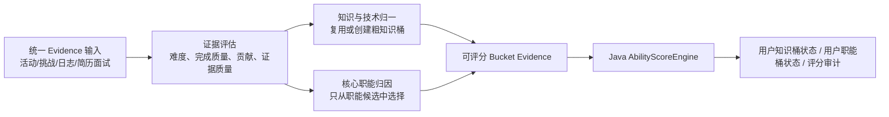

# 双标签数据契约 v1

状态：Stage 02 草案，尚未修改数据库和运行链路。  
目标：统一“活动、挑战、教练日志、简历面试”进入能力系统时的数据形状，让 LLM 做分类与证据解释，让 Java 引擎做可复现的数值计算。

## 1. 三层数据模型



1. `Evidence`：一次真实可追溯的经历，不等于能力标签。
2. `Bucket`：稳定的长期累计对象，分为知识与技术、核心职能两类。
3. `Bucket Evidence`：这条经历与某个桶的关联；它带相关度、证据点和评分输入，是唯一允许触发加分的对象。

## 2. 统一 Evidence 输入

所有来源先转为这个内部对象；第一版继续复用 `achievement_records` 和简历面试已有证据，后续 Stage 06 才补全适配器。

```json
{
  "schemaVersion": "capability-evidence-v2.0",
  "source": {
    "type": "EVENT | CHALLENGE | COACH_LOG | RESUME_INTERVIEW",
    "sourceId": "123",
    "userId": "test1",
    "occurredAt": "2026-08-13T10:00:00Z"
  },
  "activity": {
    "title": "Java 零基础入门练营",
    "content": "学习面向对象、集合和异常处理，并完成命令行学生管理练习。",
    "category": "校内",
    "organization": "示例组织",
    "structuredQualityReport": {},
    "completionEvidence": {
      "did": "完成学生管理练习并调试异常处理。",
      "learned": "理解集合选择与异常处理边界。",
      "attachments": []
    }
  },
  "integrity": {
    "idempotencyKey": "EVENT:123:test1",
    "evidenceHash": "sha256",
    "sourceCredibility": "SYSTEM_VERIFIED | ORGANIZATION | SELF_REPORTED | INTERVIEW"
  }
}
```

约束：

- 业务主键、证据哈希、原始内容快照都必须保存。
- 同一个 `idempotencyKey` 在同一规则版本下不能重复产生加分。
- Evidence 本身不直接携带最终分数。

## 3. LLM 输出：先评估事实，再归入双标签

现有 `EvidenceAssessmentAgentService` 的难度、完成质量、贡献、证据点抽取继续保留；新增双标签分类结果，但不允许 LLM 输出最终能力分。

```json
{
  "schemaVersion": "capability-classification-v2.0",
  "assessment": {
    "activityDifficulty": 35,
    "completionQuality": 0.76,
    "personalContribution": 0.82,
    "assessmentConfidence": 0.84,
    "evidenceFindings": [
      {
        "claim": "完成了命令行学生管理练习",
        "support": "用户复盘中描述了调试和异常处理",
        "confidence": 0.82
      }
    ],
    "riskFlags": []
  },
  "knowledgeBuckets": [
    {
      "decision": "REUSE",
      "bucketId": "knowledge-java",
      "bucketName": "Java",
      "normalizedBucket": "java",
      "relevance": 0.92,
      "relevanceConfidence": 0.89,
      "evidenceFindings": ["面向对象", "集合", "异常处理", "命令行练习"],
      "claimedOutcome": "掌握 Java 基础语法并完成基础练习"
    }
  ],
  "functionAssessments": [
    {
      "eligible": false,
      "reason": "本次证据以基础学习和练习为主，尚不足以证明可独立承担后端开发工作"
    }
  ]
}
```

分类边界：

- 知识与技术：优先 `REUSE` 现有粗桶；没有合理父类且确实具备长期累计价值时才 `CREATE_REVIEW`。
- 核心职能：只能从候选种子库选择，LLM 可以返回 `eligible=false` 或空数组，不能自由发明职能。
- “集合、异常处理、Controller、联合索引”永远只是 `evidenceFindings`，不是前端一级标签。
- 每条来源最多生成 3 个知识与技术桶；核心职能最多 1 个主职能和 2 个辅助职能。Stage 11 会为两个类型分别设置总预算，避免一次项目因多桶而无限放大总分。

## 4. 给 Java 评分引擎的标准输入

评分时每一个 `Bucket Evidence` 都转为一条 `ScoreableDimension`；这里的 `bucketType` 是新增字段，现有引擎的数值公式继续复用。

```json
{
  "bucketType": "KNOWLEDGE | FUNCTION",
  "bucketId": "knowledge-java",
  "dimensionName": "Java",
  "normalizedDimension": "java",
  "relevance": 0.92,
  "relevanceConfidence": 0.89,
  "role": "NONE | PRIMARY | SECONDARY",
  "assessmentRef": "ability_evidence_assessment:456",
  "evidenceQuality": 0.78,
  "novelty": 0.91,
  "sourceType": "EVENT"
}
```

字段映射：

| Java 评分输入 | 来源 | 归属 |
| --- | --- | --- |
| 当前能力分、经验值、不确定度 | 用户桶状态表 | 后端 |
| 活动难度、完成质量、个人贡献 | Evidence Evaluator | LLM 抽取后服务端校验 |
| 相关度、相关度置信度 | 双标签归类 Agent | LLM 抽取后服务端校验 |
| 证据质量 | 本地规则 60% + LLM 证据点 40% | 后端 |
| 新颖度 | 与历史 Evidence 的文本相似度 | 后端 |
| 来源可信度 | SourceType 的固定先验 | 后端 |
| 职能主次系数 | `role` | 后端配置 |

这样一分的价值仍由同一个 `AbilityScoreCalculator` 决定；LLM 只能决定“这条证据是否与某桶相关、相关到什么程度”。

## 5. 三个验收样例

| 输入 | 知识与技术预期 | 核心职能预期 |
| --- | --- | --- |
| 学习 Java 集合、异常、面向对象并完成 10 道练习 | `Java`，细证据挂在桶下 | 不更新职能 |
| 用 Java + Redis + RabbitMQ 完成秒杀项目，处理一人一单、库存预扣、超时回滚 | `Java`、`Redis`、`消息队列` | `后端开发` 主职能；必要时 `数据一致性治理` 辅助职能 |
| 在中日文化节担任双语志愿者，完成接待、翻译与现场协调 | `日语`、`跨文化沟通`（如定义为知识/通识桶） | `活动运营` 或 `跨文化沟通` 职能，取决于实际产出证据 |

## 6. 现有系统的兼容策略

- 不改动 `achievement_records` 的创建逻辑。
- 保留 `ability_evidence_assessments` 的活动质量、完成质量、贡献、风险与原始 JSON。
- 不再让 `ability_evidence_dimensions` 直接成为前台能力名称；Stage 04 后它们会映射为 v2 桶证据。
- `growth_tags` 与 `growth_tag_evidences` 暂时只读保留，直到智能简历切换到新桶与新证据。
- `AbilityHacClusteringService` 在灰度期仍可保留为旧展示兼容；新系统不把 HAC 聚类结果当作能力主数据。

## 7. Stage 02 人工验收项

请确认以下四条是否符合你的产品认知：

1. 知识与技术最多 3 个粗桶，细知识点只进入证据；核心职能最多 1 主 2 辅，并由独立预算防止分数膨胀。
2. “Java 基础练习”只提升 `Java`，不会提升 `后端开发`；“可交付后端项目”才可能提升后端开发。
3. 评分对象是桶证据而不是课程知识点；所以 Java 集合、异常处理、JVM 会共同累计到 `Java`。
4. 旧标签先只读兼容智能简历，待新桶稳定后再切换智能简历数据源。
