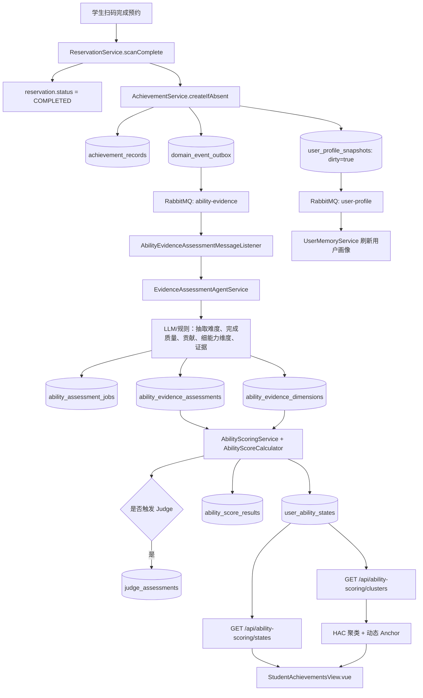

# 能力系统现状盘点

盘点日期：2026-08-13  
范围：个人成就、能力评分、Judge、智能简历、用户画像、简历面试与前端能力页。

## 结论

当前项目存在两套并行的能力数据：

| 系统 | 核心表 | 当前用途 | 状态 |
| --- | --- | --- | --- |
| 旧成长标签 | `growth_tags`、`growth_tag_evidences` | 智能简历/成长分析素材 | 保留兼容，但已不应继续作为主能力体系 |
| 评分能力 v2 | `user_ability_states`、`ability_score_results`、`ability_evidence_*` | 当前 Vue 能力页、Judge、简历面试定段 | 当前主能力体系 |
| HAC 聚类层 | `ability_dynamic_anchors` + 内存聚类结果 | 将多个 v2 细能力临时聚为一个前端卡片 | 仅展示层，需在双标签系统中下线替换 |

术语冻结：

- 知识与技术：Java、MySQL、Spring Boot、日语、RAG 这类可长期累计的粗粒度桶。
- 核心职能：后端开发、系统设计、数据一致性治理、活动运营、跨文化沟通等“能完成什么工作”的能力桶。
- 细知识点、用户心得、活动摘要只作为证据和里程碑，不单独成为前台一级能力。
- `growth_tags` 不再作为能力页主展示；迁移完成前保留为智能简历的兼容数据源。

## 当前完成活动后的实际链路

挑战完成路径与活动路径在 `AchievementService.createFromChallenge` 会合；更新历史心得则复用已有成就记录并重新投递能力证据评估消息。

## 各来源当前是否进入能力评分

| 来源 | 是否自动创建成就记录 | 是否自动进入 v2 评分 | 备注 |
| --- | --- | --- | --- |
| 扫码完成活动 | 是 | 是 | 当前最完整路径 |
| 完成挑战 | 是 | 是 | 更新挑战心得会重新评估 |
| 修改活动/挑战历史心得 | 已有记录 | 是 | 重新投递同一记录，版本和哈希防止无效重复 |
| Coach 日志 | 否 | 否 | 目前只标脏并异步刷新用户画像；Stage 06 需要适配为统一 Evidence 输入 |
| 简历面试回答 | 不写 `achievement_records` | 是 | `ResumeAbilityScoringService` 直接生成统一证据后调用同一个 Java 评分服务 |

## 当前评分职责边界

`EvidenceAssessmentAgentService` 负责把活动/挑战证据抽成结构化材料：

- `activityDifficulty`、`completionQuality`、`personalContribution`
- 细能力维度 `dimensionName / normalizedDimension / relevance`
- 证据点、风险标记、LLM 评估置信度

`AbilityScoreCalculator` 不让 LLM 直接给最终分。它将相关度、完成质量、个人贡献、新颖度、来源可信度、证据质量、当前能力、当前不确定度等因素用固定公式计算经验增量、能力分、不确定度和 Judge 标记。

目前一个活动可生成多个细能力维度；`AbilityScoringService` 会过滤相关度低于 `0.30` 的维度，并在多维度时做总预算归一化。这正是双标签改造需要把“细能力维度”归入“粗知识桶 / 核心职能桶”的入口。

## 旧 growth_tags 的真实状态

- `GrowthTagService` 仍可按成就记录抽标签、写 `growth_tags` 与 `growth_tag_evidences`，也支持里程碑。
- 但现有 `AchievementService` 不再调用它，也没有 Controller 或 MQ Listener 触发它；因此它不是完成活动后的自动主链路。
- `StudentAchievementsView.vue` 不读取它。
- `AiService.buildResumeEvidencePack` 仍读取它，为“智能简历/成长分析”提供高分标签与里程碑素材。

因此后续不能直接删除旧表。正确做法是：新双标签系统稳定后，把智能简历素材源从 `growth_tags` 切换到新证据与新桶，再把旧表降为只读兼容数据。

## HAC 动态聚类的真实职责与限制

`AbilityHacClusteringService` 读取 `user_ability_states`，使用本地特征向量、平均链接 HAC 与动态 Anchor 把相似细能力聚成页面卡片。它不参与任何实际加分。

限制：

- 聚类名称不是稳定能力主数据，只是读接口 `/clusters` 的展示结果。
- 读取 `/clusters` 时，满足数量和相似度条件的簇可能被提升为动态 Anchor，存在 GET 读接口写入数据的副作用。
- 双标签系统上线后，知识桶和职能桶将成为稳定主数据，HAC 不应再承担“合并后决定用户能力名称”的责任。

## 关键文件清单

| 模块 | 文件 | 职责 |
| --- | --- | --- |
| 成就入口 | `do-not-miss-backend/src/main/java/com/donotmiss/backend/achievement/AchievementService.java` | 创建/更新成就记录、投递能力评估和画像刷新 |
| 预约完成 | `do-not-miss-backend/src/main/java/com/donotmiss/backend/reservation/ReservationService.java` | 扫码完成后进入成就主链路 |
| 挑战完成 | `do-not-miss-backend/src/main/java/com/donotmiss/backend/challenge/ChallengeService.java` | 挑战完成后进入成就主链路 |
| 证据 Agent | `do-not-miss-backend/src/main/java/com/donotmiss/backend/abilityscore/EvidenceAssessmentAgentService.java` | LLM/规则抽取、校验、审计与调度评分 |
| 评分服务 | `do-not-miss-backend/src/main/java/com/donotmiss/backend/abilityscore/AbilityScoringService.java` | 幂等、维度预算、状态写入、触发 Judge |
| 评分公式 | `do-not-miss-backend/src/main/java/com/donotmiss/backend/abilityscore/AbilityScoreCalculator.java` | 固定公式与安全阈值 |
| Judge | `do-not-miss-backend/src/main/java/com/donotmiss/backend/abilityscore/JudgeAssessmentService.java` | 高风险评分的出题、判题和置信度调整 |
| 聚类展示 | `do-not-miss-backend/src/main/java/com/donotmiss/backend/abilityscore/AbilityHacClusteringService.java` | 细能力聚类和动态 Anchor |
| 旧标签 | `do-not-miss-backend/src/main/java/com/donotmiss/backend/achievement/GrowthTagService.java` | 遗留标签与里程碑逻辑 |
| 智能简历 | `do-not-miss-backend/src/main/java/com/donotmiss/backend/ai/AiService.java` | 当前仍读取旧标签作为简历素材 |
| 简历面试 | `do-not-miss-backend/src/main/java/com/donotmiss/backend/resumeinterview/ResumeAbilityScoringService.java` | 将面试证据接入同一评分引擎 |
| 前端能力页 | `do-not-miss-frontend/src/views/StudentAchievementsView.vue` | 读取 states、clusters、results、Judge 与证据时间线 |

## Stage 02 的硬约束

1. 新的双标签输出必须能映射到现有 `AbilityScoreEngine` 所需的细分相关度、证据质量等参数。
2. 新系统先双写，不能中断当前活动完成、挑战完成、简历面试的评分主链路。
3. 教练日志应在 Stage 06 统一适配为 Evidence，而不是另写一套加分逻辑。
4. 智能简历必须在新桶稳定后改读新表；在此之前保留旧标签只读兼容。
5. 新桶成为稳定主数据后，HAC 只可作为可选分析工具，不能继续决定前台能力的一级名称。
